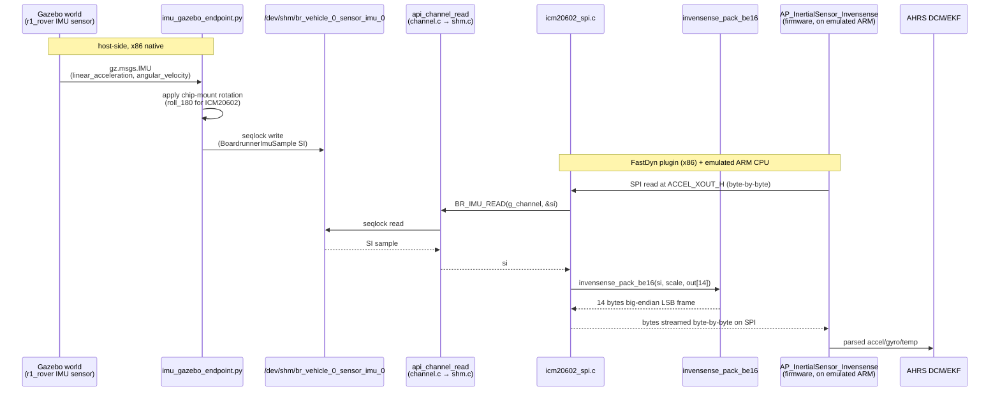
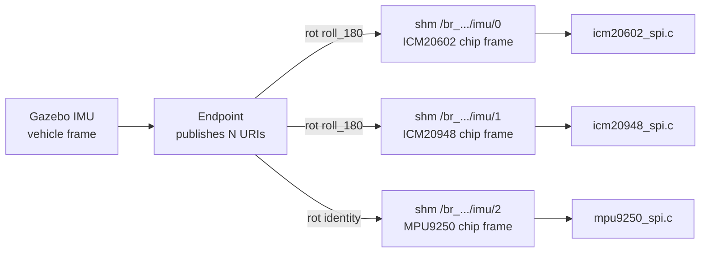
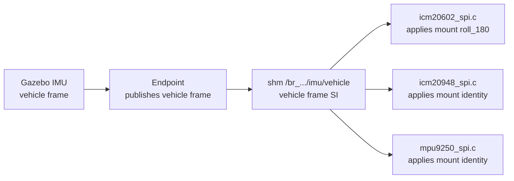
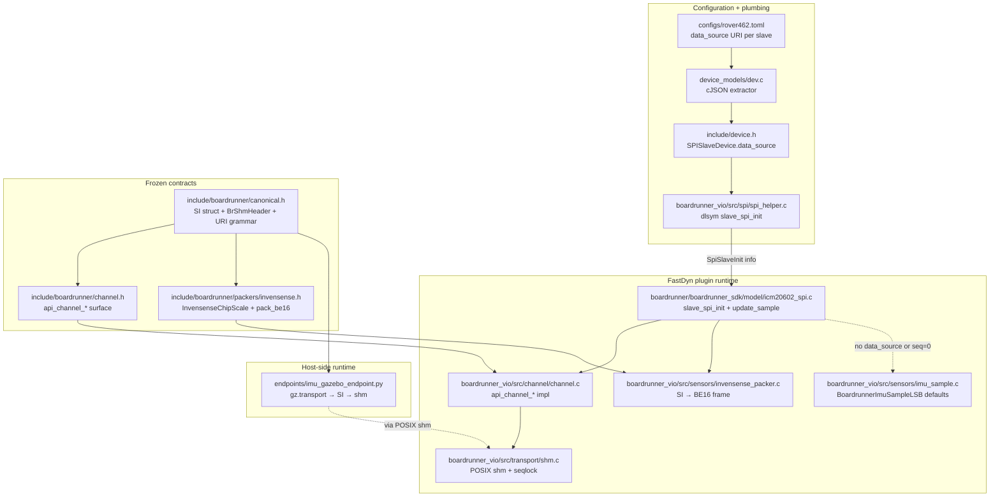

# BoardRunner VIO — Physics Integration Architecture

**Purpose.** Explain how a single Gazebo physics process delivers sensor data
into N emulated peripheral chips inside FastDyn/QEMU at MMIO level, and how
actuator commands flow the other way. Concrete for the ArduRover / CubeBlack
target, but the pattern generalises to any firmware with SPI/I2C/UART sensors.

## TL;DR

- **One physics process, one sensor topic → one endpoint → one or more shm segments → one or more chip models.**
- The endpoint converts Gazebo's sensor message into a canonical **SI-unit** sample and publishes it into a POSIX shm segment via a SPSC seqlock.
- The chip model (e.g. `icm20602_spi.c`) reads that SI sample through `api_channel_read` and hands it to a chip-family **packer** which produces the exact byte layout the firmware's SPI driver expects.
- The URI in the TOML `[[Device.<bus>.connections]] data_source` field is the only glue: it names the shm segment. If it's absent (or the writer never runs), the model falls back to today's static defaults — boot behaviour is bit-exact.

## Concepts glossary

| Component | File(s) | Role |
|---|---|---|
| **Gazebo world** | `third_party/.../worlds/r1_rover_runway.sdf` | Simulates physics. Publishes one message per SDF `<sensor>`. |
| **Endpoint script** | `virtuals/.../gazebo/endpoints/imu_gazebo_endpoint.py` | Subscribes to one Gazebo topic, converts to SI, writes to shm. Host-side, one process per sensor family. |
| **Canonical schema** | `include/boardrunner/canonical.h` | Wire format: `BrShmHeader` (64 B), SI-unit `Boardrunner{Imu,Baro,Mag,Gnss,Actuator}Sample`, URI grammar, seqlock protocol. Never chip-specific units. |
| **Channel API** | `include/boardrunner/channel.h` + `boardrunner_vio/src/channel/channel.c` | Transport-agnostic `api_channel_attach/read/write/detach`. Currently backed only by shm; UDP/tcp could plug in later. |
| **Shm transport** | `boardrunner_vio/src/transport/shm.{c,h}` | POSIX `shm_open` + `mmap` + SPSC seqlock. `br_uri_to_shm_name` maps URI ↔ shm object name. |
| **Packer** | `include/boardrunner/packers/invensense.h` + `boardrunner_vio/src/sensors/invensense_packer.c` | Chip-family conversion from SI-unit sample to the exact register byte layout the firmware reads (big-endian int16, chip-specific scaling, chip-specific accel/temp/gyro ordering). |
| **Slave model** | `boardrunner/boardrunner_sdk/model/icm20602_spi.c` (etc.) | Emulates one SPI/I2C chip. On CS transition, serves SPI transfers. When firmware reads sample registers, calls channel then packer. |
| **TOML plumbing** | `configs/rover462.toml` + `include/device.h` (`SPISlaveDevice.data_source`) + `device_models/dev.c` + `boardrunner_vio/src/spi/spi_helper.c` | Carries the `data_source` URI from TOML through the C plugin down to the slave's `slave_spi_init` hook. |
| **Boot-safety fallback** | `include/boardrunner/imu_sample.h` (renamed `BoardrunnerImuSampleLSB`) + `boardrunner_vio/src/sensors/imu_sample.c` | Old static LSB defaults, retained. Model uses them when no channel is attached or the writer never published. Guarantees today's boot behaviour is preserved. |

## Translation layers — where each unit conversion happens

This is the biggest source of confusion, so it gets its own table. **Data
starts as physics reality and ends as physics reality; every layer either
changes representation or moves bytes.**

| # | Layer | Location | In | Out | What it does |
|---|---|---|---|---|---|
| 1 | Physics simulation | Gazebo world | — | truth-frame samples | Simulates the vehicle. Publishes one `gz.msgs.IMU` per sensor tick. |
| 2 | Gazebo → wire | `gz.transport13` publisher | phys sim state | protobuf `gz.msgs.IMU` (SI, sensor frame) | Serialises. Already in SI. |
| 3 | Endpoint subscriber | `imu_gazebo_endpoint.py::on_imu` | protobuf | `BoardrunnerImuSample` (SI, still sensor frame) | Copies fields, synthesises `temp_c`. |
| 4 | Chip-mount rotation (opt) | endpoint OR slave model | sensor frame SI | chip-mount frame SI | 3×3 rotation matrix. See Option A vs B below. |
| 5 | Wire → shm | `posix_ipc` mmap + `struct.pack_into` | SI struct | shm bytes | Identity — just byte layout. |
| 6 | Shm transport | `shm.c` seqlock | shm bytes | SI struct copy in reader's stack | Identity + concurrency correctness. |
| 7 | Channel API | `channel.c` | SI struct | SI struct | Identity — just a handle wrapper. |
| 8 | **Packer** ← *the translation step* | `invensense_pack_be16` | SI struct | **14 chip-specific big-endian int16 bytes** | `float × scale + saturation + BE16 store`. Chip-family-specific factors. |
| 9 | Slave model store | `icm20602_spi.c` | 14 bytes | `s->regs[ACCEL_XOUT_H..]` | `memcpy` into the fake register file. |
| 10 | SPI bus transfer | emulated SPI bus | 1 byte at a time | firmware receives | Wire-accurate. |
| 11 | Firmware SPI driver | `AP_InertialSensor_Invensense::_read_fifo` (ArduPilot on emulated ARM) | bytes | chip int16 LSB | BE16 unpack — mirror of step 8. |
| 12 | ArduPilot scale | `_accumulate` | chip int16 LSB | m/s², rad/s, °C | **Inverse of the packer.** Chip-family-specific — must agree with our step 8 scale factors. |
| 13 | ArduPilot rotation | `AP_InertialSensor::update` | chip frame SI | vehicle frame SI | Applies `AHRS_ORIENTATION` / per-instance rotation. |
| 14 | AHRS/EKF | `AP_AHRS::update` | vehicle frame SI | attitude estimate | State estimation. |
| 15 | AHRS → telemetry | GCS_MAVLINK ATTITUDE stream | attitude | MAVLink packet | MAVLink encoding. |

**Critical invariant:** step 8 (our packer) and step 12 (ArduPilot's scale)
must use matching scale factors. If we pack with `208.86 LSB per m/s²` but
ArduPilot expects `1024 LSB per m/s²` (e.g. wrong full-scale range), the
value gets scaled wrong at step 12 and AHRS sees a phantom accel.

**Where "chip-specific" enters the pipeline:** only steps 4, 8, 11, 12. All
other layers are chip-agnostic. That's the entire point of the SI-canonical
schema — everything from the endpoint down to `api_channel_read` is
identical for every IMU chip.

## Chip families — why `invensense.h` covers three chips

Sensor vendors ship many chips with nearly-identical register maps that
differ only in scale factors, temperature calibration, or minor ordering.
Rather than one packer file per chip, we group by **chip family**.

### Invensense/TDK family (single packer file today)

Shared: SPI/I2C protocol pattern, big-endian int16 sample registers, temp
sensor with `raw = (T - room) × sensitivity` formula, similar full-scale
config registers.

Per-chip: WHOAMI value, exact register offsets, sample-block ordering
(ACCEL_TEMP_GYRO vs ACCEL_GYRO_TEMP), temperature calibration constants,
optional bank switching (ICM20948).

| Chip | Layout | Temp room | Temp sens | WHOAMI |
|---|---|---|---|---|
| MPU9250 | ACCEL_TEMP_GYRO | 21 °C | 333.87 LSB/°C | 0x71 |
| MPU6000/6500 | ACCEL_TEMP_GYRO | 36.53 °C | 340.0 LSB/°C | 0x68/0x70 |
| ICM20602 | ACCEL_TEMP_GYRO | 25 °C | 326.8 LSB/°C | 0x12 |
| ICM20649 | ACCEL_TEMP_GYRO | 21 °C | 333.87 LSB/°C | 0xE1 |
| ICM20948 | ACCEL_GYRO_TEMP (bank0) | 21 °C | 333.87 LSB/°C | 0xEA |
| ICM42688 | ACCEL_TEMP_GYRO | 25 °C | 132.48 LSB/°C | 0x47 |

`invensense.h` handles all of them via one `InvensenseChipScale` struct.
Adding a new Invensense chip = a new `invensense_scale_<chip>_default()`
helper. Zero new files.

### One packer file per vendor family, not per chip

| Family | Packer file | Chips it covers | Sensors on CubeBlack |
|---|---|---|---|
| Invensense/TDK | `packers/invensense.h` (exists) | MPU9250, ICM20602, ICM20948, ICM42688, MPU6xxx, … | 3× IMU |
| Bosch | `packers/bosch.h` (future) | BMI088, BMI055, BMP280, BMP388, BMM150 | — |
| Measurement Specialties | `packers/measurement_specialties.h` (future) | MS5611, MS5837, MS5837-30BA | 2× baro |
| Honeywell | `packers/honeywell.h` (future) | HMC5843, HMC5883, HMC5983 | 1× compass |
| QST | `packers/qst.h` (future) | QMC5883L, QMC5883P | (alternate compass) |
| u-blox | `packers/ublox.h` (future) | UBX-NAV-PVT, NAV-STATUS on M8/M9/M10 modules | 1× GPS (UART) |
| MAVLink | `packers/mavlink.h` (future) | MAVLink v2 GPS_RAW_INT for firmware-facing GPS UART | (alternate GPS) |
| IOMCU (Cube-specific) | `packers/iomcu.h` (future) | STM32F103 IOMCU coprocessor page protocol | RC-in + PWM-out on USART6 |

This is a scalable structure: one file per family, `~150 lines` of packer
logic each, reused across chips of that family. **Adding a new chip inside
an existing family = 10-line struct addition. Adding a new family = one
new file.**

## End-to-end data flow (IMU today)



**Why the seqlock:** the writer runs on the host at ~1 kHz asynchronously to
the reader's SPI transfer. Traditional locking would either block the
firmware's hot path or lose samples. SPSC seqlock: writer bumps `seq` to odd,
memcpies payload, bumps to even. Reader reads `seq` before and after payload
copy; if it changed or was odd, retry. Wait-free for the reader, ~50 ns
overhead.

**Why SI in the schema:** chip-specific LSB counts couple the endpoint to the
chip. In SI units the endpoint knows nothing about ICM20602 vs MPU9250 —
that's the packer's problem.

## The multi-chip mounting problem

CubeBlack has three IMU chips physically mounted differently on the board:

| Chip | Physical mount | Static-default `az_lsb` at rest |
|---|---|---|
| MPU9250 | ROTATION_YAW_270, chip Z-up | **+2048** (Z-positive) |
| ICM20948 | ROTATION_YAW_270, chip Z-up (mostly) | -2048 (per current defaults) |
| ICM20602 | ROTATION_ROLL_180_YAW_270, chip Z-**down** | **-2048** (Z-negative) |

At rest, each chip reads gravity with a different sign on Z because the chips
face different directions. Gazebo publishes ONE physical IMU sample per
timestep — but each chip needs it rotated into that chip's own frame before
being packed. Two clean ways to handle this.

### Option A — one URI per chip



- **Endpoint knows chip mounts.** Publishes N times per Gazebo tick, once per URI, each with the appropriate chip-mount rotation applied on the host side.
- **Models are dumb.** Each slave model just reads its own URI's shm segment and packs the bytes.
- **Multi-vehicle scales cleanly:** `boardrunner://vehicle/1/sensor/imu/0` reuses the same shape.

**Pros:** Zero new C-side abstractions. If we ever want to inject different data into different chips (e.g. force IMU inconsistency for chaos testing) it falls out for free.
**Cons:** Endpoint carries chip-specific knowledge (mount matrices) that arguably belongs closer to the chip model.

### Option B — one URI, chip applies mount



- **Endpoint publishes vehicle-frame SI**, one shm segment.
- **Each slave model** knows its own chip's mount rotation and applies it before packing.
- Requires extending `InvensenseChipScale` with a rotation matrix and threading it through `invensense_pack_be16`.

**Pros:** Vehicle-frame is the true "source of truth" — matches how ArduPilot conceptually thinks. Endpoint is chip-agnostic. Adding an IMU chip needs no endpoint change.
**Cons:** More work in the C layer (packer signature grows). Harder to inject different data per chip.

### When to pick which

- Option A is faster to ship, easier to debug, and matches how our Python endpoint already thinks (per-chip mount arg on the CLI).
- Option B is architecturally cleaner and is what we'd want long-term.

**Current recommendation: A now, B as a Phase-4 cleanup once the pattern is validated end-to-end.**

## Static component graph

Where each source file lives and what depends on what.



## Concrete walkthrough — ICM20602 today

**Config** (`configs/rover462.toml`):

```toml
[[Device.spi4.connections]]
    type          = "slave"
    name          = "icm20602_spi.c"
    cs_id         = 4
    device_scroll = "boardrunner/boardrunner_sdk/build/icm20602_spi.so"
    data_source   = "boardrunner://vehicle/0/sensor/imu/0"
```

**URI → shm object name**: `boardrunner://vehicle/0/sensor/imu/0` → `/br_vehicle_0_sensor_imu_0`. Rule: strip `boardrunner://`, replace `/` with `_`, prepend `/br_`.

**Startup sequence**:

1. FastDyn boots. Python parser reads TOML → serialises `data_source` into `fastdyn_recent_run/dev_config.json`.
2. C plugin (`dev.c`) parses that JSON, `strdup`s the URI into `SPISlaveDevice.data_source`.
3. `spi_helper.c` loads `icm20602_spi.so` via `dlopen`, resolves `slave_spi_transfer` + `slave_spi_set_cs` (mandatory) and `slave_spi_init` (optional), then calls `slave_spi_init(&SpiSlaveInit{ data_source="boardrunner://…", … })`.
4. `slave_spi_init` in `icm20602_spi.c` calls `api_channel_attach(uri, BR_ROLE_READER, sizeof(BoardrunnerImuSample))`. That opens or creates `/dev/shm/br_vehicle_0_sensor_imu_0` (4 KB, 64 B header + 48 B payload slot).
5. Endpoint (running separately) writes SI samples via a mirroring `posix_ipc` writer at ~1 kHz.

**Per-sample hot path** (fires every time firmware reads `ACCEL_XOUT_H`):

```c
static void icm20602_update_sample(ICM20602State *s) {
    BoardrunnerImuSample si;
    if (g_channel != NULL && BR_IMU_READ(g_channel, &si)) {
        uint8_t frame[14];
        invensense_pack_be16(&si, &g_scale, frame);
        memcpy(&s->regs[ICM20602_REG_ACCEL_XOUT_H], frame, sizeof(frame));
    } else {
        // Boot-safety fallback: legacy static LSB defaults.
        BoardrunnerImuSampleLSB lsb;
        boardrunner_imu_get_sample("icm20602", &lsb);
        // ... store lsb.ax_lsb etc. big-endian directly ...
    }
}
```

**Firmware then reads** the 14 contiguous bytes over SPI byte-by-byte via
`slave_spi_transfer`. Same wire behaviour as a real chip.

## URI grammar

```
boardrunner://vehicle/<vid>/sensor/<kind>/<inst>
boardrunner://vehicle/<vid>/actuator/<kind>/<channel>
```

- `<kind>` ∈ `{ imu, baro, mag, gnss, pwm }`
- `<vid>`, `<inst>`, `<channel>` are decimal integers, no leading zeros
- URI → shm name: strip `boardrunner://`, replace `/` with `_`, prepend `/br_`

Examples:

| URI | shm name |
|---|---|
| `boardrunner://vehicle/0/sensor/imu/0` | `/br_vehicle_0_sensor_imu_0` |
| `boardrunner://vehicle/0/sensor/baro/0` | `/br_vehicle_0_sensor_baro_0` |
| `boardrunner://vehicle/0/actuator/pwm/3` | `/br_vehicle_0_actuator_pwm_3` |

## SPSC seqlock protocol

Header field `seq` (uint64_t, atomic-accessed) with these invariants:
- `seq == 0` → sentinel: no writer has ever committed. Reader falls back to static defaults.
- `seq odd` → writer is mid-write. Reader retries.
- `seq even, > 0` → writer has committed. Reader may copy payload.

**Writer** (bump-odd, memcpy, bump-even):
```
seq = seq + 1                      // odd; enter update
memcpy(slot, &sample, size)
last_write_ns = now()
seq = seq + 1                      // even; commit
```

**Reader** (with retry limit for torn reads):
```
loop:
    s0 = load(seq)
    if s0 == 0: return NO_WRITER
    if s0 odd: continue
    memcpy(&out, slot, size)
    s1 = load(seq)
    if s0 == s1: return OK
    // else writer wrote during our copy — retry
return TORN
```

Wait-free for the reader on x86 (all 8-byte aligned loads are naturally
atomic + TSO-ordered).

## Adding a new sensor family (recipe)

1. **Canonical schema**: add `BoardrunnerXxxSample` struct in `canonical.h` (SI units, `seq + timestamp_ns + fields + flags`).
2. **Typed macros**: add `BR_XXX_READ` / `BR_XXX_WRITE` in `channel.h`.
3. **Packer**: create `include/boardrunner/packers/<chipfamily>.h` + `boardrunner_vio/src/sensors/<chipfamily>_packer.c`. SI → chip register bytes.
4. **Slave model**: add `slave_spi_init` (or `slave_i2c_init` when we add I2C plumbing) that attaches a channel from `data_source`. Refactor sample-fetch to try `BR_XXX_READ` then fall back to legacy defaults.
5. **TOML**: add `data_source = "boardrunner://vehicle/0/sensor/<kind>/<inst>"` on the slave's connection block.
6. **Endpoint**: new `<kind>_gazebo_endpoint.py` under `virtuals/.../gazebo/endpoints/`. Same shape as `imu_gazebo_endpoint.py`.

Rebuild boardrunner_sdk. Rebuild `libfastdyn.so` only if you touched `device.h` or `dev.c`.

## Full-firmware future state — everything wired to Gazebo

This is what the complete architecture looks like once every sensor and
actuator family the CubeBlack firmware exercises is plumbed through VIO.
Nothing here is speculative — each block below is a concrete file, TOML
entry, or URI following the pattern we've validated with ICM20602.

```mermaid
flowchart TB
    subgraph Gazebo["Gazebo World (r1_rover_runway.sdf)"]
        gzimu[imu_sensor @ 1 kHz]
        gzmag[magnetometer_sensor @ 50 Hz]
        gzgps[navsat_sensor @ 10 Hz]
        gzbaro[air_pressure_sensor @ 50 Hz]
        gzpose[/joint_states + /pose/]
        gzactcmd[Rover motion commands<br/>from ArduPilotPlugin socket]
    end

    subgraph Endpoints["Host-side endpoints — one process per sensor family"]
        epimu[imu_gazebo_endpoint.py<br/>publishes N URIs<br/>per-chip mount rotations]
        epmag[mag_gazebo_endpoint.py]
        epgps[gnss_gazebo_endpoint.py]
        epbaro[baro_gazebo_endpoint.py<br/>publishes 2 URIs<br/>one per baro instance]
        eppwm[pwm_gazebo_endpoint.py<br/>reads 16 shm segments<br/>sends UDP to Gazebo]
    end

    subgraph Shm["/dev/shm — canonical SI segments"]
        s_imu0[imu/0 - ICM20602]
        s_imu1[imu/1 - ICM20948]
        s_imu2[imu/2 - MPU9250]
        s_mag[mag/0]
        s_gps[gnss/0]
        s_baro0[baro/0 - MS5611 SPI1]
        s_baro1[baro/1 - MS5611 SPI4]
        s_pwm0[actuator/pwm/0..15<br/>one per servo channel]
    end

    subgraph Packers["Packers — one file per vendor family"]
        pkinv[invensense.h/.c<br/>ICM/MPU family]
        pkhon[honeywell.h/.c<br/>HMC58xx family]
        pkub[ublox.h/.c<br/>UBX protocol]
        pkms[measurement_specialties.h/.c<br/>MS56xx family]
        pkiomcu[iomcu.h/.c<br/>Cube coprocessor pages]
    end

    subgraph Slaves["Slave/peripheral models — one file per physical chip or bus"]
        sicm602[icm20602_spi.c]
        sicm948[icm20948_spi.c]
        smpu[mpu9250_spi.c]
        smag[hmc5843_i2c.c or qmc5883_i2c.c<br/>on I2C1]
        sgps[usart3.c + gps_ublox_uart.c<br/>UART UBX encoder]
        sbaro0[ms5611_spi1.c]
        sbaro1[ms5611_spi4.c]
        siomcu[usart6.c IOMCU handler<br/>RC-in read + PWM-out capture]
    end

    subgraph Firmware["Firmware on emulated ARM (ArduRover)"]
        fwins[AP_InertialSensor]
        fwmag[AP_Compass]
        fwgps[AP_GPS]
        fwbaro[AP_Baro]
        fwrc[AP_RCProtocol via IOMCU]
        fwout[AP_HAL::RCOutput via IOMCU]
        fwahrs[AHRS / EKF3]
    end

    gzimu --> epimu
    gzmag --> epmag
    gzgps --> epgps
    gzbaro --> epbaro
    gzactcmd -.-> eppwm

    epimu --> s_imu0
    epimu --> s_imu1
    epimu --> s_imu2
    epmag --> s_mag
    epgps --> s_gps
    epbaro --> s_baro0
    epbaro --> s_baro1

    s_imu0 --> sicm602
    s_imu1 --> sicm948
    s_imu2 --> smpu
    s_mag --> smag
    s_gps --> sgps
    s_baro0 --> sbaro0
    s_baro1 --> sbaro1

    sicm602 --> pkinv
    sicm948 --> pkinv
    smpu --> pkinv
    smag --> pkhon
    sgps --> pkub
    sbaro0 --> pkms
    sbaro1 --> pkms
    siomcu --> pkiomcu

    sicm602 --> fwins
    sicm948 --> fwins
    smpu --> fwins
    smag --> fwmag
    sgps --> fwgps
    sbaro0 --> fwbaro
    sbaro1 --> fwbaro
    siomcu --> fwrc

    fwout --> siomcu
    siomcu --> s_pwm0
    s_pwm0 --> eppwm

    fwins --> fwahrs
    fwmag --> fwahrs
    fwgps --> fwahrs
    fwbaro --> fwahrs
```



### What this diagram tells us about scalability

**Rows of the diagram = kinds of concern, not sensor types.** From top to bottom:

1. **Gazebo world** — one node per SDF `<sensor>` (or command topic). Grows one-for-one with what physics simulates.
2. **Endpoints** — one process per sensor *family*, publishes N shm URIs per family. Grows one for each new sensor family (not per chip). Total ≈ 5-6 processes for a fully-plumbed vehicle.
3. **Shm segments** — one per chip instance (option A) or per family (option B). File count grows linearly with instances (~15 segments total for a full CubeBlack).
4. **Packers** — one per vendor family. Grows very slowly: three chips of the same vendor share one file.
5. **Slave models** — one per physical chip / bus. Already scales cleanly today.
6. **Firmware** — untouched. Sees exactly the SPI/I2C/UART bytes it would see on real hardware.

### Scalability inspection: adding new things

| What you're adding | Files that change |
|---|---|
| New chip in an existing family (e.g. ICM42688 for a new board) | +10 lines in the family's packer, +1 slave model file (~200 lines), +1 TOML connection block |
| New chip in a new family (e.g. LSM6DSOx from ST) | +1 packer header + .c file (~200 lines each), +1 slave model, +1 TOML block |
| New sensor kind entirely (e.g. lidar/rangefinder) | +1 `BoardrunnerLidarSample` in `canonical.h`, +1 packer family, +1 endpoint script, +1 slave model, +1 TOML block. Roughly a day of work per new kind. |
| Second identical vehicle | No code change — new TOML with `vehicle/1/...` URIs, new endpoint instance |
| Different actuator protocol (e.g. CAN ESC instead of PWM) | +1 packer family (CAN protocol), +1 slave model (CAN peripheral), +1 endpoint. Same shape. |

### Not shown here (deferred)

- Multi-vehicle: `boardrunner://vehicle/1/...` works today but needs endpoints/writers spawned per vehicle. Trivial when we need it.
- Non-Gazebo physics: replacing Gazebo with a Python physics stub only touches the endpoint. Chip models don't care.
- Fault injection / chaos: a fault-injector process attaches as an extra writer with `data_source` pointed at any URI. `Vec3NoiseModel` (from friend's `services.cpp`) can layer noise inside the endpoint.

## Boot-safety guarantee

Any slave model that has NOT been refactored to the channel API keeps
calling `boardrunner_imu_get_sample(name, &lsb)` (renamed struct
`BoardrunnerImuSampleLSB`) — behaviour is bit-exact vs pre-VIO.

A refactored slave with `data_source` absent from TOML gets NULL from
`slave_spi_init` and stays on the fallback path — also bit-exact.

A refactored slave with `data_source` set but no writer running attaches a
channel; `BR_IMU_READ` returns false on `seq == 0`; fallback path runs —
also bit-exact.

The only case that changes runtime behaviour is: `data_source` set AND a
writer is publishing. That's the intended live-physics case.
