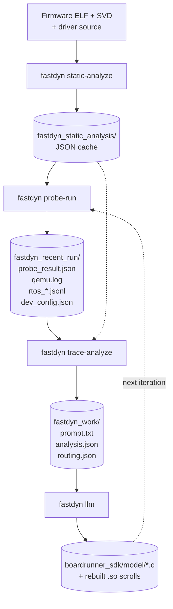
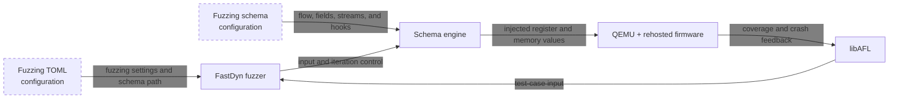
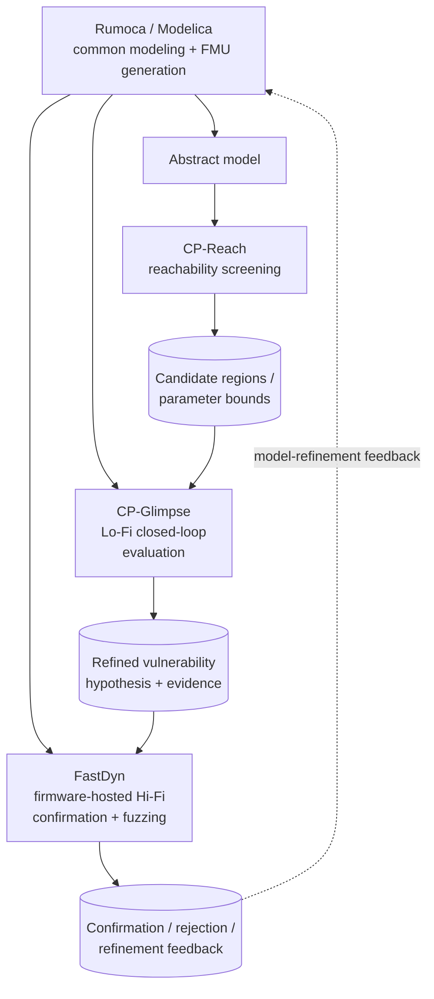

# FastDyn Rehosting and Fuzzing Integration Guide

*FIRE FastDyn | STR Integration Documentation | Main branch (As-of-date 30 Aug 2026)*

**Purpose.** This guide documents FastDyn's integration path for automatic rehosting and schema-driven fuzzing. It covers the CLI entry points and parameters, the multi-stage rehosting pipeline (currently: static analysis → probe run → trace analysis → LLM), the artifacts produced at each stage, the container build/run procedure, and FastDyn's role in the FIRE multi-fidelity workflow. Given a firmware ELF, its driver source tree, and a machine description (SVD + TOML), FastDyn can iteratively generate peripheral device models until the firmware reaches the required functionality. Once an input-processing path is rehosted, a JSON fuzzing schema can describe that path without a target-specific C harness, allowing the same rehosted firmware to be fuzzed.

| STR requested information | Covered in |
|---|---|
| CLI parameters and usage | Section 1: `fastdyn` entry point, subcommand reference, invocation examples. |
| How the tool consumes models, firmware, and fuzzing inputs | Section 2: static-analysis cache, `boardrunner_sdk` model layout, TOML conventions, and fuzzing schema. |
| Workflow / integration example | Section 3: rehosting loop plus schema examples; Section 5 walk-through. |
| FIRE toolchain relationship | Section 4: FastDyn's role in the multi-fidelity workflow, relationship to other FIRE tools, and schema-driven fuzzing integration. |
| Docker build and smoke test | Section 5: container build, verification steps, expected artifacts, integration checklist. |
| IP-sensitivity of LLM prompts | Section 6: transparent account of what firmware content is sent to the LLM. |

> **Architecture status note.** FastDyn's LLM-driven rehost stage is under active development. The user-facing contract this document intends to keep stable is the **CLI-driven pipeline shape** (a small set of subcommands invoked from a container, driven by a single TOML per firmware, producing artifacts under a work directory) rather than the exact command names or stage boundaries. The **TOML configuration schema**, the **Docker build recipe**, the **static-analysis cache format**, and the **artifact categories listed in §5.4** are intended to remain consistent. The current pipeline exposes four subcommands (`static-analyze`, `probe-run`, `trace-analyze`, `llm`); future revisions may consolidate or rename stages — in particular, `trace-analyze` and `llm` may merge into a single execution step. Integration automation should pin a tested FastDyn revision and expect that command names, `llm`-side flags, and internal artifact files may change between revisions.

## Integration workflows at a glance

### Automatic rehosting



Each iteration of this loop either advances the firmware past a previously unhandled MMIO access, refines a peripheral model that returned wrong values, or emits a routing decision when the LLM determines that a different peripheral is at fault. The loop terminates when the firmware reaches a user-specified milestone (control loop, arming, first sensor read, etc.) without further MMIO faults. Schema-driven fuzzing is a subsequent activity.

### Schema-driven fuzzing



> **Scope note.** The automatic-rehosting portion of this document omits the hardware-trace (`twintrace`) record/replay flow and the `LIBHW=true` physical-hardware backend. The schema-driven fuzzer described here operates on rehosted firmware and does not require a hardware trace. The subcommand reference below flags options belonging to hardware-mode flows as *(hardware-mode; not used here)*.

## 1. CLI Interface

**Entry point.** The installed command is `fastdyn` (also registered as `boardrunner`), declared in `setup.py` under `console_scripts` as `fastdyn = fastdyn.main:cli`. The implementation is in `src/fastdyn/main.py`.

```bash
# Verify the installed interface
fastdyn --help

# Discover subcommands
fastdyn static-analyze --help
fastdyn probe-run     --help
fastdyn trace-analyze --help
fastdyn llm           --help
```

FastDyn is driven by a single TOML per firmware/board pair (typically under `configs/`). The TOML defines the QEMU machine, memory backing, ELF path, plugin options, and the peripheral model routing table. Command-line flags are intentionally minimal; most behavior comes from the TOML so that the same configuration can be reused across `probe-run`, `trace-analyze`, and rerun automation.

### 1.1 Automatic-rehosting and fuzzing subcommands

The primary rehosting and fuzzing commands share the `-c/--config` flag and read from the same TOML. Output directories default to sensible sibling paths and can be overridden via `-o/--work-dir`. The flag tables below list the primary, stable options for each command; additional tuning flags are exposed by each subcommand's `--help` and are part of the current execution model that may evolve.

#### 1.1.1 `fastdyn static-analyze`

Builds the offline analysis cache from the ELF and SVD. Runs once per firmware; subsequent stages reuse the cache.

| Flag | Type / Default | Purpose |
|---|---|---|
| `-c, --config` | path (required) | TOML configuration for the target board. |
| `--binary` | path (override) | Overrides `[CPU.cpu0].binary`. Useful when swapping firmware variants against the same board TOML. |
| `-s, --svd` | path (default: `third_party/common/cmsis-svd-data`) | SVD file or directory of SVDs. FastDyn selects by `[Machine].platform`. |
| `--force` | flag | Recompute even if the cache directory is populated. |
| `--format` | choice: `json` | Output format (only `json` currently). |

Reads `[Rehosting.directories]` for `static_analysis_cache_dir` and `firmware_source_roots`, and reads `[Rehosting.static_analysis.macros]` for macro-extraction settings.

#### 1.1.2 `fastdyn probe-run`

Executes the firmware under QEMU with the FastDyn plugin loaded. On an unhandled MMIO access, the plugin captures the fault (address, PC, program state) and either records it into `probe_faults.json` (for later routing) or attempts an auto-generated stub model on-the-fly.

| Flag | Type / Default | Purpose |
|---|---|---|
| `-c, --config` | path (required) | TOML configuration. |
| `-o, --work-dir` | path (default: `./fastdyn_work`) | Output directory. |
| `-s, --svd` | path (override) | SVD override for this run. |
| `--run-gdb` | flag | Override `[Machine].enable_gdb`. When on, QEMU pauses at reset and exposes gdbstub on `localhost:1234`. |
| `--rtos-introspect` | flag | Enable RTOS thread introspection using the schema produced by `static-analyze`. |

Additional flags controlling work-dir persistence and RTOS-trace verbosity are documented in `fastdyn probe-run --help`.

Preconditions: a valid static-analysis cache. If the cache is missing or stale, run `static-analyze --force` first.

#### 1.1.3 `fastdyn trace-analyze`

Consumes the probe-run artifacts plus the static-analysis cache, correlates them, and produces a structured LLM prompt plus a routing decision file. Deterministic — does not call the LLM.

| Flag | Type / Default | Purpose |
|---|---|---|
| `-c, --config` | path (required) | TOML configuration. |
| `-o, --work-dir` | path (default: `./fastdyn_work`) | Directory where the LLM prompt, analysis metadata, and per-analysis snapshot subdirectory are written. |
| `--latest-run-dir` | path (default: auto-discover) | Path to the probe-run output directory (`fastdyn_recent_run/`). |
| `-s, --svd` | path (override) | SVD override. |
| `--force` | flag | Recompute even if analysis output already exists. |

Additional flags controlling routing hand-offs between iterations and per-analysis prompt naming are documented in `fastdyn trace-analyze --help`; those are part of the current stage-based execution model and may evolve.

Preconditions: `probe_result.json` from a completed probe-run and a valid static-analysis cache.

#### 1.1.4 `fastdyn llm`

Sends the prompt to the configured LLM provider (OpenAI or Ollama), parses the response, patches model files, and optionally recompiles.

| Flag | Type / Default | Purpose |
|---|---|---|
| `-d, --work-dir` | path (required) | Directory containing the LLM prompt and optional analysis metadata. |
| `-o, --output` | path (repeatable, optional) | Target model `.c` file(s) to patch. Auto-detected from analysis metadata when omitted. |
| `--model` | str | Model name (e.g., `gpt-4o`, or an Ollama-hosted model tag). |
| `--model-provider` | choice: `openai\|ollama` | Backend selection. |
| `--env-file` | path (default: `~/.fastdyn.env`) | Loads `OPENAI_API_KEY` from this file. |
| `--compile / --no-compile` | flag | Rebuild the affected model `.so` after applying the patch. |
| `--sdk-dir` | path (default: `boardrunner/boardrunner_sdk`) | SDK root for compilation. |
| `--evaluate / --no-evaluate` | flag | Append per-call metrics to the LLM history directory. |
| `--ollama-url` | url | Ollama server endpoint. |

Additional flags controlling sampling temperature, reasoning-effort, retry behavior, conversation state, and Ollama tuning parameters are documented in `fastdyn llm --help`; the set may evolve as the LLM stage's execution model matures.

The `llm` subcommand accepts prompts produced by `trace-analyze` and writes patches, new files, or routing decisions back into the work directory. The set of response types and the iteration control mechanism are implementation details of the current execution model and may change in future revisions; the CLI shape and I/O contract remain stable.

#### 1.1.5 `fastdyn run` for schema-driven fuzzing

Runs the firmware in QEMU using the selected TOML. For a fuzzing campaign, the
TOML must enable `fuzzing` and `coverage` and provide `fuzzing_schema` in its
`[Machine]` section.

| Flag | Type / Default | Purpose |
|---|---|---|
| `-c, --config` | path (required) | TOML configuration for the fuzzing target. |
| `-o, --work-dir` | path (default: `./fastdyn_work`) | Campaign output directory, including corpus and coverage artifacts. |
| `-p, --persist-work-dir` | flag | Preserve the existing work directory so a later campaign can reuse its corpus. |
| `-s, --svd` | path (optional) | Override the SVD file or directory. |

### 1.2 Docker execution

The repository includes a `Dockerfile` at the project root that produces a complete FastDyn environment (Ubuntu 24.04 base, patched QEMU, Ghidra 12.0.4, Gazebo Harmonic, Python venv, and the FastDyn plugin `libfastdyn.so`).

```bash
# From the workspace directory that contains FastDyn/, qemu/, libhw/
docker build -f FastDyn/Dockerfile -t fastdyn-env .

# Interactive container with the CLI on PATH
docker run --rm -it fastdyn-env

# Non-interactive one-shot invocation
docker run --rm -v "$PWD/configs:/mnt/configs" fastdyn-env \
  fastdyn static-analyze -c /mnt/configs/rover462.toml \
  -s third_party/common/cmsis-svd-data --force
```

The image entrypoint drops into `/workspace/FastDyn` with the Python venv activated. `fastdyn` and `boardrunner` are both on `PATH`. `LD_LIBRARY_PATH` includes the libhw output directory; `GHIDRA_INSTALL_DIR` is set for the static-analysis frontend.

### 1.3 Secondary subcommands (reference only)

The CLI also exposes `loop`, `swarm`, `timing-summary`, and `harness` for orchestration and instrumentation, plus `verifier`, `fuzz`, and `generate` for hardware-mode workflows out of scope for this document. Run `fastdyn --help` for their signatures.

## 2. How FastDyn Consumes Models and Firmware Inputs

### 2.1 Primary inputs

| Input | Provided as | Purpose |
|---|---|---|
| Firmware ELF | `[CPU.cpu0].binary` in TOML | The image QEMU executes and the static analyzer reads. |
| Machine description | `[Machine]`, `[Memory]`, `[CPU]` in TOML | QEMU target selection, memory backing, timer / semihosting / GDB options. |
| Peripheral routing table | `[Device.*]` in TOML | Which peripheral models handle which MMIO ranges, and which slave devices are attached to shared buses. |
| MCU / SVD description | `-s/--svd` or default `third_party/common/cmsis-svd-data` | Maps MMIO addresses to peripheral and register names. |
| Firmware driver source roots | `[Rehosting.directories].firmware_source_roots` | Provides ArduPilot-style HAL drivers for macro extraction and source context in prompts. |
| Firmware build roots | `[Rehosting.directories].firmware_build_roots` | Provides compile-unit metadata (DWARF, preprocessed macros) when the source tree alone is insufficient. |
| Modeling directory | `[Rehosting.directories].modeling_dir` | Where LLM-generated peripheral models live (`boardrunner/boardrunner_sdk/model/*.c`). |

### 2.2 Static analysis cache layout

After `fastdyn static-analyze`, the cache directory contains a stable set of JSON artifacts consumed by every downstream stage. The layout groups into five categories:

| Category | Artifacts |
|---|---|
| Binary metadata | `binary.json`, `sections.json`, `segments.json` — ELF header, sections, load segments. |
| Symbols and source | `symbols.json`, `functions.json`, `compile_units.json`, `source_map.json` — demangled symbols, function bounds, DWARF-driven source mapping. |
| Peripheral map | `svd_map.json`, `svd_summary.json`, `vector_table.json`, `irq_handlers.json` — SVD-aligned peripheral / register maps plus Cortex-M vector table and IRQ handler symbols. |
| RTOS introspection | `rtos_identity.json`, `rtos_symbols.json`, `rtos_schema.json`, `rtos_schema.txt` — RTOS type detection and event schema for the probe-run tracer. |
| Static analysis | `callgraph.json`, `probe_faults.json`, `macro_context.json`, `macros/`, `constants.json`, `literal_pools.json`, `mmio_constants.json` — call graph, predicted MMIO fault sites, preprocessor macros, and constant pools. |

### 2.3 Peripheral models — `boardrunner_sdk` layout

Peripheral models live under `boardrunner/boardrunner_sdk/`. Each peripheral is represented by one C file in `model/*.c`; each file compiles to a same-named `.so` scroll in `boardrunner/boardrunner_sdk/build/`. The scrolls are loaded by the FastDyn plugin based on the TOML routing table.

```
boardrunner/boardrunner_sdk/
├── boardrunner_vio/          shared VIO / API library (SPI, I2C, DMA, PTY, FIFO, signals)
│   └── src/
├── include/boardrunner/      public headers exposed to model writers
│   ├── vio.h                 umbrella header
│   ├── spi.h, i2c.h, dma.h, signals.h, pty.h, net.h, fifo.h, fileio.h
├── model/                    one .c file per peripheral or slave
│   ├── rcc.c, pwr.c, systick.c, dwt.c, flash.c
│   ├── gpioa.c … gpioi.c
│   ├── spi1.c, spi2.c, spi4.c, i2c1.c, i2c2.c
│   ├── usart2.c, usart3.c, uart4.c, uart7.c, uart8.c, usart6.c
│   ├── icm20602_spi.c, icm20948_spi.c, mpu9250_spi.c   (SPI slaves)
│   ├── ms5611_spi1.c, ms5611_spi4.c, ramtron_fram_spi.c
│   └── ap_iomcu_uart_endpoint.py                         (host-side endpoint helper)
└── build/                    per-model .so artifacts (generated)
```

Each `[Device.<name>]` block in the TOML declares an MMIO range and points at one `.so` handler; optional `[[Device.<name>.connections]]` sub-blocks declare either **slaves** (real devices attached to the bus — routed to QEMU via the plugin) or **endpoints** (host-side backends only — informational, not forwarded). This lets a single `spi4.c` bus controller multiplex several slave device models (ICM20602, ICM20948, MS5611) on different chip-select lines.

### 2.4 Iterative discovery loop

`probe-run` does not require the modeling directory to be complete before it starts. When the firmware performs an MMIO access to a range that is either not covered by any `[Device.*]` block or handled by a stub, the FastDyn plugin captures the fault. The next stages (`trace-analyze` → `llm`) either fill in a new model file, update an existing one, or emit a routing decision that renames / relocates the responsibility. Progress across iterations is tracked by counting basic-block coverage of the firmware image and by the milestone symbol list in `[Machine].milestones`.

### 2.5 Schema-driven fuzzing

Once rehosting has made an input-processing path reliable, FastDyn can fuzz it
without a target-specific C harness. A JSON fuzzing schema describes where a
test case begins and ends, where its values are delivered, and which values
are fuzzed, fixed, or computed. Enable the feature and name the schema in the
target TOML:

```toml
[Machine]
fuzzing = true
coverage = true
fuzzing_schema = "path/to/schema.json"
```

The main schema sections are `flow`, `fields`, `streams`, and `hooks`.

#### 2.5.1 Fuzzing loop

`flow` defines one repeatable test-case loop. **Snap** is immediately before
the target consumes input: FastDyn restores the snapshot, obtains a fresh
fuzzer input, and injects ordinary fields. **Sync** is after that input has
been processed; its `resume` address restarts execution for the next test
case, and should be directed to the address of snap. Often, there are
multiple points at which an input handler can exit, and multiple sync points
are required.

```json
"flow": {
  "snap": { "at": "0x08002000" },
  "sync": { "at": "0x08002080", "resume": "0x08002000" }
}
```

#### 2.5.2 Fields, locations, and types

Each field has a unique `name`, a `type`, and an output `size` in bytes. A
field with a `location` is written directly to the target; a locationless
field is delivered through a stream.

```json
{ "name": "message_id", "location": "r2 + 4", "type": "uint", "size": 2 }
```

Except for `reg(N)`, a location is a memory-address expression. It can use
register values, arithmetic, and pointer dereferences.

| Location | Meaning |
|---|---|
| `reg(1)` | Write directly to register `r1`. |
| `0x20001000` | Write to an absolute memory address. |
| `r2` | Use the value in `r2` as the destination address. |
| `r2 + 0x10` | Write at an offset from the address in `r2`. |
| `[r3]` | Follow a pointer stored at `r3`. |
| `u16[r3 + 6]` | Read a 16-bit unsigned address from memory. |

The basic types are `int`, `uint`, `float`, and `data`; by default each uses
fuzzed bytes of the requested size. `data` is useful for opaque byte blocks,
while the other types communicate the intended meaning of a value. Any basic
type—not just `data`—can use `options.constant` for a fixed value, for example:

```json
{ "name": "version", "type": "uint", "size": 1,
  "options": { "constant": 2 } }
```

For `data`, the constant is an array of bytes, such as `[255, 71]`; for
`int`, `uint`, and `float`, it is a number that fits the selected type and
size.

`length` and `checksum` are computed types that preserve message structure:

| Type | Options | Result |
|---|---|---|
| `length` | `fields`, `byte_order`; optional `fuzzable` | Encodes the combined size of named fields or a finite stream. |
| `checksum` | `algorithm`, `over`, `byte_order` | Emits a CRC over the named field or stream bytes. |

Set `fuzzable: true` on a length field when the campaign should also explore
incorrect lengths. Checksums support `"crc16-modbus"` and
`"crc16-mcrf4xx"`; place a checksum after the bytes it covers in a stream.

#### 2.5.3 Streams and hooks

A stream models input that firmware consumes incrementally, such as UART
data. It has a destination location, an optional `chunk_size` (one byte by
default), and optionally an ordered list of fields that form one finite
message. A stream without `fields` is an open-ended raw input source.

```json
{ "name": "uart_rx", "location": "r1",
  "fields": ["header", "payload_length", "payload", "crc"] }
```

A hook is the firmware address at which FastDyn injects a delayed direct field
or emits the next stream chunk. Everything not named by a hook is injected at
snap. The property is named `fields`, but it may list fields and streams.

```json
"hooks": [
  { "at": "0x08002110", "fields": ["uart_rx"] }
]
```

## 3. Combining Stages: Rehosting and Fuzzing Workflow

The rehost pipeline's subcommands compose into a single deterministic loop. The following is the intended per-iteration sequence, plus how a caller reruns individual stages when they need to.

### 3.1 First-iteration flow

The concrete four-command sequence and its expected outputs are documented in §5.3 (rehost pipeline) and §5.4 (expected artifacts). After each pass, callers loop back to `probe-run`; coverage growth and milestone hits recorded in `analysis.json` are the intended per-iteration success signal.

### 3.2 Rerunning individual stages

Under the current execution model, callers rerun stages manually as described below. Future revisions may consolidate this into a more autonomous loop; the CLI invocations documented here will continue to work either way.

Each stage is idempotent when re-invoked with `--force`:

- Re-run `static-analyze --force` when the firmware ELF changes.
- Re-run `probe-run` after any change to a model `.so`; the cache is unaffected.
- Re-run `trace-analyze` when the LLM has produced a `routing.json` that needs to become the next prompt, or when the last probe-run produced different exit reasons.
- Re-run `llm` when adjusting the model, provider, or other invocation parameters against the same prompt.

### 3.3 Fuzzing examples after rehosting

Fuzzing begins after the rehosting loop has made the selected input path
repeatable. It is not another automatic-rehosting stage: use the rehosted
firmware, select a parser interface, and supply a schema that represents that
interface. The two common patterns are a framed stream and a pre-existing
parser buffer.

#### Framed UART message

This schema feeds a UART receive routine one byte at a time. It retains a
fixed header, fuzzes the message identifier and payload, calculates a length,
and appends a CRC:

```json
{
  "flow": {
    "snap": { "at": "0x080d7b72" },
    "sync": { "at": "0x080d7ce6", "resume": "0x080d7b72" }
  },
  "fields": [
    { "name": "available_bytes", "location": "reg(0)", "type": "length", "size": 1,
      "options": { "fields": ["uart_rx"], "byte_order": "little" } },
    { "name": "header", "type": "data", "size": 2,
      "options": { "constant": [255, 71] } },
    { "name": "message_id", "type": "uint", "size": 2 },
    { "name": "payload_size", "type": "length", "size": 1,
      "options": { "fields": ["payload"], "byte_order": "little", "fuzzable": true } },
    { "name": "payload", "type": "data", "size": 16 },
    { "name": "frame_crc", "type": "checksum", "size": 2,
      "options": { "algorithm": "crc16-modbus", "over": ["uart_rx"], "byte_order": "little" } }
  ],
  "streams": [
    { "name": "uart_rx", "location": "r1",
      "fields": ["header", "message_id", "payload_size", "payload", "frame_crc"] }
  ],
  "hooks": [
    { "at": "0x080d7bbc", "fields": ["uart_rx"] }
  ]
}
```

#### Parser buffer and its length

When firmware already has a complete input buffer, direct fields are simpler.
This example fuzzes a message class, identifier, payload, and its
little-endian payload length in the existing parser structure:

```json
{
  "fields": [
    { "name": "ubx_class", "location": "r0 + 0x47a", "type": "data", "size": 1 },
    { "name": "ubx_msg_id", "location": "r0 + 0x475", "type": "data", "size": 1 },
    { "name": "payload_length_le", "location": "r0 + 0x476", "type": "length", "size": 2,
      "options": { "fields": ["ubx_payload"], "byte_order": "little", "fuzzable": true } },
    { "name": "ubx_payload", "location": "r0 + 0x62", "type": "data", "size": 1040 }
  ]
}
```

Launch a schema-driven fuzzing campaign with:

```bash
fastdyn run -c <config.toml>
```

Add `-p` to continue a previous campaign and reuse its existing corpus:

```bash
fastdyn run -c <config.toml> -p
```

## 4. FIRE Project Integration Vision

### 4.1 FastDyn's role in FIRE

FastDyn is the **firmware-hosted high-fidelity confirmation** layer of the FIRE multi-fidelity workflow. It sits downstream of the abstract and Lo-Fi cyber-physical analysis stages: candidates identified by CP-Reach and refined by CP-Glimpse become concrete parameter sets and scenario configurations that FastDyn executes against the actual firmware image, running under an instruction-accurate QEMU with LLM-generated peripheral models. Once an input-processing path is rehosted, schema-driven fuzzing (§4.4) is the mechanism by which FastDyn contributes vulnerability evidence back to the workflow.

| Tool / layer | Primary role in FIRE | Typical input | Typical output |
|---|---|---|---|
| Rumoca | Modelica authoring, compilation, model generation, and interoperability layer. | Modelica package / class. | Symbolic / DAE representation, simulation-ready model, generated code, FMU artifact. |
| CP-Reach | Fast abstract screening of bounded disturbances and reachable unsafe regions. | Abstracted system model + disturbance / parameter bounds. | Candidate unsafe regions, parameter bounds, vulnerability hypotheses. |
| CP-Glimpse | Scenario-defined multi-component Lo-Fi closed-loop evaluation with detailed cyber-physical models. | Rumoca-managed model components + vulnerability model / parameters + scenario YAML. | Time-series evidence, refined vulnerability hypotheses, validated parameter ranges. |
| **FastDyn** | **Firmware-hosted Hi-Fi confirmation that integrates the refined cyber-physical model with the actual hosted firmware and higher-fidelity execution / environment behavior, plus schema-driven fuzzing of rehosted interfaces.** | **Refined cyber-physical model + vulnerability hypothesis / scenario + hosted firmware.** | **Confirmation or rejection of the vulnerability hypothesis, Hi-Fi evidence, crash / coverage artifacts, and model-refinement feedback.** |

### 4.2 Relationship to other FIRE tools

**Rumoca as the common modeling layer.** FastDyn does not author its own physics models. Vehicle plants, sensor models, actuator models, and environment blocks used to close the loop against the emulated firmware should be authored in Modelica through Rumoca and materialized as FMU-3 artifacts. FastDyn already includes an FMU-driven simulation harness (`fastdyn.fmu_build`, activated via `[FMU]` sections in the TOML), so a Rumoca-authored Modelica model can be reused across CP-Glimpse and FastDyn without independent re-implementation.

**CP-Reach handoff.** Reachability results from CP-Reach constrain the FastDyn scenario space: parameter bounds and unsafe operating regions identified upstream become the initial conditions and disturbance profiles applied to the FMU plant that FastDyn drives against the firmware.

**CP-Glimpse handoff.** When a Lo-Fi vulnerability candidate is confirmed by CP-Glimpse, FastDyn confirms whether the effect persists once the real firmware's timing, scheduler, sensor sampling, actuator quantization, and driver-level behavior are applied. Where possible, the same physical parameters, disturbance definitions, and observable outputs are preserved across the CP-Glimpse → FastDyn transition so that any disagreement can be attributed to model fidelity or firmware behavior rather than scenario drift.

**Feedback to upstream stages.** If FastDyn's firmware-hosted result disagrees with the CP-Glimpse prediction, the mismatch feeds back to earlier modeling stages. The Rumoca model, reachability abstraction, vulnerability surrogate, parameter bounds, or component timing can be revised and the analysis repeated. FastDyn is the firmware-hosted confirmation stage of an iterative model-refinement workflow, not an isolated final simulator.

### 4.3 Multi-fidelity workflow



**Key integration principle.** Fidelity increases from CP-Reach → CP-Glimpse → FastDyn, but system identity, vulnerability hypothesis, parameter provenance, and scenario intent remain traceable across every stage. What allows a reachability finding to become a reproducible Lo-Fi test, a meaningful firmware-hosted confirmation, and — once rehosted — a fuzzing target with concrete coverage and crash evidence, is exactly this preserved provenance.

### 4.4 Schema-driven fuzzing integration

Fuzzing is the validation and vulnerability-discovery activity that follows a
successful rehosting milestone. The workflow is:

1. Identify an externally controlled interface, such as a parser buffer, UART
   receive routine, or network packet path.
2. Choose safe snap and completion points, then determine the registers or
   buffers that carry its input.
3. Start with small `data` fields; use a stream when the firmware consumes
   input incrementally.
4. Add constants, lengths, and checksums only where they help the parser reach
   deeper behavior. Keep fields in wire order for framed streams.
5. Run the campaign, confirm that input reaches the intended parser, and
   refine the schema as target behavior becomes clearer.

This schema is a useful hand-off format for FIRE tools. Static or dynamic
analysis can propose parser locations, buffer expressions, message layouts,
and derived values; a user or another tool can then generate and review JSON
instead of implementing a custom harness. The selected control-flow points and
memory locations should be reviewed before a campaign begins.

```text
Fuzzer input ──> schema fields / streams ──> FastDyn injection hooks ──> rehosted firmware
     ^                                                                        │
     └──────────── coverage, crashes, and progress ───────────────────────────┘
```

## 5. Recommended STR Run Procedure and Smoke Test

### 5.1 Container build

From the workspace directory that contains FastDyn/, qemu/, libhw/:

```bash
docker build -f FastDyn/Dockerfile -t fastdyn-env .
```

The build runs `setup.sh --clone-qemu --build-qemu --build-gazebo --skip-optifuzz` and then `make PROBE=true DEV=true LIBHW=true LIBGZ=true FLIGHT_CONTROLLERS=true DEBUG_PRINT=true LIBFUZZ=true`. The resulting image is self-contained: no host QEMU or Ghidra install is required.

### 5.2 Verify the CLI is installed and visible

```bash
docker run --rm fastdyn-env fastdyn --help
# Expected: click-based help listing static-analyze, probe-run, trace-analyze,
# llm, run, loop, swarm, verifier, fuzz, timing-summary, harness, generate.
```

### 5.3 Run the rehost pipeline and fuzzing smoke test

The delivered reference board is ArduRover 4.6.2 on CubeBlack (`configs/rover462.toml`). The firmware image is included at `virtuals/physics/flight_controllers/courbet/bin/ardurover_v462`.

```bash
# Step 1 — offline analysis
fastdyn static-analyze \
  -c configs/rover462.toml \
  -s third_party/common/cmsis-svd-data \
  --force

# Step 2 — probe run (produces artifacts under fastdyn_recent_run/)
fastdyn probe-run \
  -c configs/rover462.toml \
  -o fastdyn_recent_run \
  --rtos-introspect

# Step 3 — trace analysis (produces prompt.txt under fastdyn_work/)
fastdyn trace-analyze \
  -c configs/rover462.toml \
  -o fastdyn_work \
  --latest-run-dir fastdyn_recent_run

# Step 4 — LLM stage (patches models and rebuilds .so scrolls)
fastdyn llm \
  -d fastdyn_work \
  --compile \
  --model gpt-4o \
  --evaluate
```

After the selected input path has been rehosted, create or select a fuzzing
configuration with `fuzzing = true`, `coverage = true`, and `fuzzing_schema`
set in `[Machine]`. Start the campaign with:

```bash
# Step 5 — schema-driven fuzzing
fastdyn run -c <fuzzing-config.toml>

# Continue a previous campaign with its existing corpus
fastdyn run -c <fuzzing-config.toml> -p
```

Additional tuning flags for each step (RTOS-trace verbosity and buffer limits, sampling temperature, reasoning-effort, retries) are available via each subcommand's `--help`; the values shown above are the minimum set needed to complete a smoke run.

### 5.4 Expected artifacts

| Artifact | Purpose / expected content |
|---|---|
| `fastdyn_static_analysis/` | JSON cache of ELF metadata, DWARF, SVD map, RTOS schema, macro extraction, and probe-fault predictions. Reused by every subsequent stage. |
| `fastdyn_recent_run/probe_result.json` | Exit reason, final PC, unique / total basic-block counts, retained BBL trace, RTOS summary, and (if applicable) the address of the unhandled MMIO fault. |
| `fastdyn_recent_run/qemu.log` | Full QEMU emulation log with the plugin's memory / DMA trace lines interleaved. |
| `fastdyn_recent_run/rtos_summary.json` | Thread table with priorities, states, and scheduled counts. |
| `fastdyn_recent_run/rtos_recent_switches.jsonl` | Recent context switches in event mode. |
| `fastdyn_recent_run/dev_config.json` | Fully materialized device / handler / slave table derived from the TOML. |
| `fastdyn_work/prompt.txt` | The LLM prompt for this iteration. Contains loaded-peripheral summary, RTOS context, DMA / memory trace excerpts, execution-trace summary, source context, macros, and diagnostic instructions. |
| `fastdyn_work/analysis.json` | Metadata for the prompt: analysis_id, run_id, prompt_kind, target_peripheral, exit_reason, config path, modeling dir. |
| `fastdyn_work/routing.json` | (Iteration-produced) LLM routing decision when the pipeline cannot identify the fault peripheral. Consumed on the next `trace-analyze` iteration when routing is applied. |
| `fastdyn_work/trace_analysis/<analysis_id>/` | Per-analysis snapshot: `prompt.txt`, `selected_source.c`, `selected_macros.json`, `io_context.json`, `exec_trace.json`, `analysis.json`. |
| `fastdyn_llm_history/` | Persistent history: `NNN_prompt.txt`, `NNN_response_*.txt` per iteration, plus `metrics.jsonl` when `--evaluate` is used. |
| `boardrunner/boardrunner_sdk/model/*.c`, `.../build/*.so` | Patched / newly created peripheral models and their compiled scrolls. |
| `fastdyn_work/corpus/` | Interesting fuzzing inputs retained by the campaign. Preserve this directory with `fastdyn run -p` to continue from the prior corpus. |
| `fastdyn_work/crashes/` | Inputs associated with crashes found during a fuzzing campaign. |
| `fastdyn_work/stats.jsonl` | Fuzzing campaign progress and statistics. |
| `fastdyn_work/bbl.txt`, `fastdyn_work/edges.txt` | Basic-block coverage; edge coverage is written when enabled. |
| `fastdyn_work/fuzzer.log`, `fastdyn_work/timeout.log` | Fuzzer runtime and timeout diagnostics. |

### 5.5 STR integration checklist

- Verify that the FastDyn image builds successfully from the provided `Dockerfile` and that `fastdyn --help` runs inside the container.
- Verify that a valid `.env` file (or environment variables) is available with `OPENAI_API_KEY` before invoking `fastdyn llm --model-provider openai`, or that a running Ollama endpoint is reachable at `--ollama-url` when using `--model-provider ollama`.
- Run `static-analyze` against the reference `configs/rover462.toml` and confirm that `fastdyn_static_analysis/` contains the artifacts enumerated in §2.2.
- Run one `probe-run` iteration and confirm that `probe_result.json` and `qemu.log` are produced, and that `rtos_summary.json` shows a non-zero thread count when RTOS introspection is enabled.
- Run `trace-analyze` and confirm that `prompt.txt` and `analysis.json` are produced under both `fastdyn_work/` and `fastdyn_work/trace_analysis/<analysis_id>/`.
- Run `fastdyn llm --evaluate` and confirm that a new `NNN_prompt.txt` / `NNN_response_1.txt` pair appears under `fastdyn_llm_history/` and that `metrics.jsonl` gets a new record.
- Verify that any generated `boardrunner_sdk/model/*.c` compiles cleanly against `libboardrunner_vio.so` and that the resulting `.so` loads on the next `probe-run` without warnings.
- Verify that repeated iterations of the rehost loop monotonically increase unique-basic-block coverage or advance the last-hit milestone recorded in `analysis.json`.
- For a rehosted input path, enable `fuzzing` and `coverage` in the target TOML, supply a reviewed fuzzing schema, and confirm that generated input reaches the intended parser.

## 6. Firmware-Content Transparency for LLM Prompts

This section is an honest account of what firmware-derived content ends up in the prompt sent to the LLM, so that integrators whose firmware is IP-sensitive can make an informed decision.

**Always included** (when the corresponding data is available in the static-analysis cache):

- Source snippets from the driver source tree for functions touched by the execution trace, up to a bounded window per function (currently around 260 lines).
- Function symbols in both mangled and demangled form, restricted to functions observed in the trace or explicitly requested by reference.
- Preprocessor macro definitions transitively referenced by the selected source snippets (not the full build's macro closure).
- MMIO register access log: addresses, register names resolved via SVD, values, PCs.
- Compressed execution-trace summary (callgraph-collapsed, not raw PC sequence) plus CPU register snapshot at the point of interest.
- The `[Device.<target>]` TOML section for the peripheral currently under analysis, so the LLM knows the MMIO range and connected slaves.
- Board hardware summary table (loaded peripherals, ranges, descriptions, connection topology).

**Conditionally included:**

- RTOS context (thread names, priorities, states, recent context switches) only when RTOS introspection is enabled and the schema is present in the cache.
- The current device-model source (the `.c` file being patched) only when the pipeline is targeting a known peripheral, not when it is asking the LLM for a routing decision on an unclassified fault.
- The full text of a prior LLM routing decision, only when a subsequent `trace-analyze` iteration consumes it, and only in the specific analysis directory for that iteration.

**Never included:**

- Absolute host filesystem paths. All source paths are normalized to `source_root_relative` (e.g., `libraries/AP_HAL_ChibiOS/UARTDriver.cpp` rather than the full host path).
- Git remote URL, branch, or commit hash of the firmware source.
- TOML sections other than the target peripheral's own block.
- Memory / register values from outside the observed trace window.
- Environment variables, credentials, or `~/.fastdyn.env` contents.

**No built-in redaction beyond the above.** There is currently no CLI flag to force a symbol-only prompt that omits source snippets, nor a heuristic to redact specific identifier names inside a selected snippet. Integrators whose firmware source cannot be disclosed to a third-party LLM should either run against a local Ollama endpoint (via `--model-provider ollama --ollama-url ...`), or gate FastDyn behind their own review of the material in `fastdyn_work/trace_analysis/<analysis_id>/prompt.txt` and `selected_source.c` before invoking `fastdyn llm`. Every prompt is persisted to `fastdyn_llm_history/NNN_prompt.txt` before the LLM call, so an out-of-band review or filter can be inserted at that point.

## 7. Reference Configuration

The delivered reference board configuration is `configs/rover462.toml`, an ArduRover 4.6.2 on CubeBlack (STM32F427):

```toml
[Rehosting.directories]
static_analysis_cache_dir = "./fastdyn_static_analysis"
firmware_source_roots     = ["/path/to/ardupilot"]
firmware_build_roots      = ["/path/to/ardupilot_build"]
modeling_dir              = "boardrunner/boardrunner_sdk/model"

[Machine]
platform    = "STM32F427"
qemu_path   = "../qemu/build/qemu-system-arm"
icount      = { shift = 5, sleep = false, align = false }
enable_gdb  = false
log_file    = "qemu.log"

[CPU]
[[CPU.cpu0]]
arch            = "arm"
machine         = "cortexm"
cpu             = "cortex-m4"
plugin_library  = "build/libfastdyn.so"
binary          = "virtuals/physics/flight_controllers/courbet/bin/ardurover_v462"
init_nsvtor     = "0x08004000"

[Device.rcc]
ranges = [["0x40023800", "0x40023c00"]]
[[Device.rcc.handlers]]
model   = "elder"
enabled = true
scroll  = "boardrunner/boardrunner_sdk/build/rcc.so"

[Device.spi4]
ranges = [["0x40013400", "0x40013800"]]
[[Device.spi4.handlers]]
model   = "elder"
enabled = true
scroll  = "boardrunner/boardrunner_sdk/build/spi4.so"

[[Device.spi4.connections]]
type          = "slave"
name          = "icm20602_spi.c"
cs_id         = 4
bus           = "spi"
device_scroll = "boardrunner/boardrunner_sdk/build/icm20602_spi.so"
```

Additional peripheral blocks (GPIO A–I, PWR, SPI1 / SPI2, I2C1 / I2C2, USART2 / 3 / 6, UART4 / 7 / 8, DMA1 / DMA2, SysTick, DWT, Flash, SDIO, TIM1 / 2 / 4 / 5, RTC, IWDG, SCB, OTG_FS) follow the same pattern.

---

**Reference repository.** FastDyn — internal to the FIRE program. The reference firmware / physics assets for the ArduPilot family live under `virtuals/physics/flight_controllers/courbet/`. A companion vehicle-authoring workflow via Rumoca is available under `[FMU]` blocks in the copter / plane variants (`configs/copter462.toml`, `configs/plane462.toml`).
