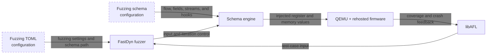
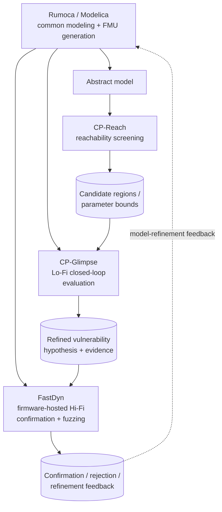

# FastDyn Fuzzing Integration Guide

*FIRE FastDyn | STR Integration Documentation | Main branch (As-of-date 30 Aug 2026)*

**Purpose.** This guide documents FastDyn's integration path for schema-driven fuzzing. It covers the CLI entry point and parameters, the inputs FastDyn consumes, the artifacts a campaign produces, the container build/run procedure, and FastDyn's role in the FIRE multi-fidelity workflow. Once an input-processing path of a firmware is rehosted, a JSON fuzzing schema can describe that path without a target-specific C harness, allowing the rehosted firmware to be fuzzed.

Automatic rehosting (generating the peripheral models until the firmware reaches the required functionality) is done by [PhantomSmith](https://github.com/PSecLab/PhantomSmith), which drives FastDyn. Its integration guide, `docs/Rehosting_Integration.md` in the PhantomSmith repository, covers the rehosting steps, their artifacts, and what firmware content reaches the LLM.

| STR requested information | Covered in |
|---|---|
| CLI parameters and usage | Section 1: `fastdyn` entry point, subcommand reference, invocation examples. |
| How the tool consumes models, firmware, and fuzzing inputs | Section 2: TOML inputs and fuzzing schema. |
| Workflow / integration example | Section 3: schema examples; Section 5 walk-through. |
| FIRE toolchain relationship | Section 4: FastDyn's role in the multi-fidelity workflow, relationship to other FIRE tools, and schema-driven fuzzing integration. |
| Docker build and smoke test | Section 5: container build, verification steps, expected artifacts, integration checklist. |

## Schema-driven fuzzing at a glance



> **Scope note.** This document omits the hardware-trace (`twintrace`) record/replay flow and the `LIBHW=true` physical-hardware backend. The schema-driven fuzzer described here operates on rehosted firmware and does not require a hardware trace.

## 1. CLI Interface

**Entry point.** The installed command is `fastdyn` (also registered as `boardrunner`), declared in `setup.py` under `console_scripts` as `fastdyn = fastdyn.main:cli`. The implementation is in `src/fastdyn/main.py`.

```bash
# Verify the installed interface
fastdyn --help

# Discover the run options
fastdyn run --help
```

FastDyn is driven by a single TOML per firmware/board pair (typically under `configs/`). The TOML defines the QEMU machine, memory backing, ELF path, plugin options, and the peripheral model routing table. Command-line flags are intentionally minimal; most behavior comes from the TOML so that the same configuration can be reused across `run`, `loop`, `swarm`, and rerun automation.

### 1.1 `fastdyn run` for schema-driven fuzzing

Runs the firmware in QEMU using the selected TOML. For a fuzzing campaign, the
TOML must enable `fuzzing` and `coverage` and provide `fuzzing_schema` in its
`[Machine]` section.

| Flag | Type / Default | Purpose |
|---|---|---|
| `-c, --config` | path (required) | TOML configuration for the fuzzing target. |
| `-o, --work-dir` | path (default: `./fastdyn_work`) | Campaign output directory, including corpus and coverage artifacts. |
| `-p, --persist-work-dir` | flag | Preserve the existing work directory so a later campaign can reuse its corpus. |
| `-s, --svd` | path (optional) | Override the SVD file or directory. |

### 1.2 Docker execution

The repository includes a `Dockerfile` at the project root that produces a complete FastDyn environment (Ubuntu 24.04 base, patched QEMU, Ghidra 12.0.4, Gazebo Harmonic, Python venv, and the FastDyn plugin `libfastdyn.so`).

```bash
# From the workspace directory that contains FastDyn/, qemu/, libhw/
docker build -f FastDyn/Dockerfile -t fastdyn-env .

# Interactive container with the CLI on PATH
docker run --rm -it fastdyn-env

# Non-interactive one-shot invocation
docker run --rm -v "$PWD/configs:/mnt/configs" fastdyn-env \
  fastdyn run -c /mnt/configs/<fuzzing-config.toml>
```

The image entrypoint drops into `/workspace/FastDyn` with the Python venv activated. `fastdyn` and `boardrunner` are both on `PATH`. `LD_LIBRARY_PATH` includes the libhw output directory; `GHIDRA_INSTALL_DIR` is set for the static-analysis frontend.

### 1.3 Secondary subcommands (reference only)

The CLI also exposes `loop`, `swarm`, `timing-summary`, and `harness` for orchestration and instrumentation, plus `verifier`, `fuzz`, and `generate` for hardware-mode workflows out of scope for this document. Run `fastdyn --help` for their signatures.

## 2. How FastDyn Consumes Models and Firmware Inputs

### 2.1 Primary inputs

| Input | Provided as | Purpose |
|---|---|---|
| Firmware ELF | `[CPU.cpu0].binary` in TOML | The image QEMU executes. |
| Machine description | `[Machine]`, `[Memory]`, `[CPU]` in TOML | QEMU target selection, memory backing, timer / semihosting / GDB options. |
| Peripheral routing table | `[Device.*]` in TOML | Which peripheral models handle which MMIO ranges, and which slave devices are attached to shared buses. |
| MCU / SVD description | `-s/--svd` or default `third_party/common/cmsis-svd-data` | Maps MMIO addresses to peripheral and register names. |

### 2.2 Schema-driven fuzzing

Once rehosting has made an input-processing path reliable, FastDyn can fuzz it
without a target-specific C harness. A JSON fuzzing schema describes where a
test case begins and ends, where its values are delivered, and which values
are fuzzed, fixed, or computed. Enable the feature and name the schema in the
target TOML:

```toml
[Machine]
fuzzing = true
coverage = true
fuzzing_schema = "path/to/schema.json"
```

The main schema sections are `flow`, `fields`, `streams`, and `hooks`.

#### 2.2.1 Fuzzing loop

`flow` defines one repeatable test-case loop. **Snap** is immediately before
the target consumes input: FastDyn restores the snapshot, obtains a fresh
fuzzer input, and injects ordinary fields. **Sync** is after that input has
been processed; its `resume` address restarts execution for the next test
case, and should be directed to the address of snap. Often, there are
multiple points at which an input handler can exit, and multiple sync points
are required.

```json
"flow": {
  "snap": { "at": "0x08002000" },
  "sync": { "at": "0x08002080", "resume": "0x08002000" }
}
```

#### 2.2.2 Fields, locations, and types

Each field has a unique `name`, a `type`, and an output `size` in bytes. A
field with a `location` is written directly to the target; a locationless
field is delivered through a stream.

```json
{ "name": "message_id", "location": "r2 + 4", "type": "uint", "size": 2 }
```

Except for `reg(N)`, a location is a memory-address expression. It can use
register values, arithmetic, and pointer dereferences.

| Location | Meaning |
|---|---|
| `reg(1)` | Write directly to register `r1`. |
| `0x20001000` | Write to an absolute memory address. |
| `r2` | Use the value in `r2` as the destination address. |
| `r2 + 0x10` | Write at an offset from the address in `r2`. |
| `[r3]` | Follow a pointer stored at `r3`. |
| `u16[r3 + 6]` | Read a 16-bit unsigned address from memory. |

The basic types are `int`, `uint`, `float`, and `data`; by default each uses
fuzzed bytes of the requested size. `data` is useful for opaque byte blocks,
while the other types communicate the intended meaning of a value. Any basic
type—not just `data`—can use `options.constant` for a fixed value, for example:

```json
{ "name": "version", "type": "uint", "size": 1,
  "options": { "constant": 2 } }
```

For `data`, the constant is an array of bytes, such as `[255, 71]`; for
`int`, `uint`, and `float`, it is a number that fits the selected type and
size.

`length` and `checksum` are computed types that preserve message structure:

| Type | Options | Result |
|---|---|---|
| `length` | `fields`, `byte_order`; optional `fuzzable` | Encodes the combined size of named fields or a finite stream. |
| `checksum` | `algorithm`, `over`, `byte_order` | Emits a CRC over the named field or stream bytes. |

Set `fuzzable: true` on a length field when the campaign should also explore
incorrect lengths. Checksums support `"crc16-modbus"` and
`"crc16-mcrf4xx"`; place a checksum after the bytes it covers in a stream.

#### 2.2.3 Streams and hooks

A stream models input that firmware consumes incrementally, such as UART
data. It has a destination location, an optional `chunk_size` (one byte by
default), and optionally an ordered list of fields that form one finite
message. A stream without `fields` is an open-ended raw input source.

```json
{ "name": "uart_rx", "location": "r1",
  "fields": ["header", "payload_length", "payload", "crc"] }
```

A hook is the firmware address at which FastDyn injects a delayed direct field
or emits the next stream chunk. Everything not named by a hook is injected at
snap. The property is named `fields`, but it may list fields and streams.

```json
"hooks": [
  { "at": "0x08002110", "fields": ["uart_rx"] }
]
```

## 3. Fuzzing Examples After Rehosting

Fuzzing begins after rehosting has made the selected input path
repeatable. It is not an automatic-rehosting stage: use the rehosted
firmware, select a parser interface, and supply a schema that represents that
interface. The two common patterns are a framed stream and a pre-existing
parser buffer.

#### Framed UART message

This schema feeds a UART receive routine one byte at a time. It retains a
fixed header, fuzzes the message identifier and payload, calculates a length,
and appends a CRC:

```json
{
  "flow": {
    "snap": { "at": "0x080d7b72" },
    "sync": { "at": "0x080d7ce6", "resume": "0x080d7b72" }
  },
  "fields": [
    { "name": "available_bytes", "location": "reg(0)", "type": "length", "size": 1,
      "options": { "fields": ["uart_rx"], "byte_order": "little" } },
    { "name": "header", "type": "data", "size": 2,
      "options": { "constant": [255, 71] } },
    { "name": "message_id", "type": "uint", "size": 2 },
    { "name": "payload_size", "type": "length", "size": 1,
      "options": { "fields": ["payload"], "byte_order": "little", "fuzzable": true } },
    { "name": "payload", "type": "data", "size": 16 },
    { "name": "frame_crc", "type": "checksum", "size": 2,
      "options": { "algorithm": "crc16-modbus", "over": ["uart_rx"], "byte_order": "little" } }
  ],
  "streams": [
    { "name": "uart_rx", "location": "r1",
      "fields": ["header", "message_id", "payload_size", "payload", "frame_crc"] }
  ],
  "hooks": [
    { "at": "0x080d7bbc", "fields": ["uart_rx"] }
  ]
}
```

#### Parser buffer and its length

When firmware already has a complete input buffer, direct fields are simpler.
This example fuzzes a message class, identifier, payload, and its
little-endian payload length in the existing parser structure:

```json
{
  "fields": [
    { "name": "ubx_class", "location": "r0 + 0x47a", "type": "data", "size": 1 },
    { "name": "ubx_msg_id", "location": "r0 + 0x475", "type": "data", "size": 1 },
    { "name": "payload_length_le", "location": "r0 + 0x476", "type": "length", "size": 2,
      "options": { "fields": ["ubx_payload"], "byte_order": "little", "fuzzable": true } },
    { "name": "ubx_payload", "location": "r0 + 0x62", "type": "data", "size": 1040 }
  ]
}
```

Launch a schema-driven fuzzing campaign with:

```bash
fastdyn run -c <config.toml>
```

Add `-p` to continue a previous campaign and reuse its existing corpus:

```bash
fastdyn run -c <config.toml> -p
```

## 4. FIRE Project Integration Vision

### 4.1 FastDyn's role in FIRE

FastDyn is the **firmware-hosted high-fidelity confirmation** layer of the FIRE multi-fidelity workflow. It sits downstream of the abstract and Lo-Fi cyber-physical analysis stages: candidates identified by CP-Reach and refined by CP-Glimpse become concrete parameter sets and scenario configurations that FastDyn executes against the actual firmware image, running under an instruction-accurate QEMU with LLM-generated peripheral models. Once an input-processing path is rehosted, schema-driven fuzzing (§4.4) is the mechanism by which FastDyn contributes vulnerability evidence back to the workflow.

| Tool / layer | Primary role in FIRE | Typical input | Typical output |
|---|---|---|---|
| Rumoca | Modelica authoring, compilation, model generation, and interoperability layer. | Modelica package / class. | Symbolic / DAE representation, simulation-ready model, generated code, FMU artifact. |
| CP-Reach | Fast abstract screening of bounded disturbances and reachable unsafe regions. | Abstracted system model + disturbance / parameter bounds. | Candidate unsafe regions, parameter bounds, vulnerability hypotheses. |
| CP-Glimpse | Scenario-defined multi-component Lo-Fi closed-loop evaluation with detailed cyber-physical models. | Rumoca-managed model components + vulnerability model / parameters + scenario YAML. | Time-series evidence, refined vulnerability hypotheses, validated parameter ranges. |
| **FastDyn** | **Firmware-hosted Hi-Fi confirmation that integrates the refined cyber-physical model with the actual hosted firmware and higher-fidelity execution / environment behavior, plus schema-driven fuzzing of rehosted interfaces.** | **Refined cyber-physical model + vulnerability hypothesis / scenario + hosted firmware.** | **Confirmation or rejection of the vulnerability hypothesis, Hi-Fi evidence, crash / coverage artifacts, and model-refinement feedback.** |

### 4.2 Relationship to other FIRE tools

**Rumoca as the common modeling layer.** FastDyn does not author its own physics models. Vehicle plants, sensor models, actuator models, and environment blocks used to close the loop against the emulated firmware should be authored in Modelica through Rumoca and materialized as FMU-3 artifacts. FastDyn already includes an FMU-driven simulation harness (`fastdyn.fmu_build`, activated via `[FMU]` sections in the TOML), so a Rumoca-authored Modelica model can be reused across CP-Glimpse and FastDyn without independent re-implementation.

**CP-Reach handoff.** Reachability results from CP-Reach constrain the FastDyn scenario space: parameter bounds and unsafe operating regions identified upstream become the initial conditions and disturbance profiles applied to the FMU plant that FastDyn drives against the firmware.

**CP-Glimpse handoff.** When a Lo-Fi vulnerability candidate is confirmed by CP-Glimpse, FastDyn confirms whether the effect persists once the real firmware's timing, scheduler, sensor sampling, actuator quantization, and driver-level behavior are applied. Where possible, the same physical parameters, disturbance definitions, and observable outputs are preserved across the CP-Glimpse → FastDyn transition so that any disagreement can be attributed to model fidelity or firmware behavior rather than scenario drift.

**Feedback to upstream stages.** If FastDyn's firmware-hosted result disagrees with the CP-Glimpse prediction, the mismatch feeds back to earlier modeling stages. The Rumoca model, reachability abstraction, vulnerability surrogate, parameter bounds, or component timing can be revised and the analysis repeated. FastDyn is the firmware-hosted confirmation stage of an iterative model-refinement workflow, not an isolated final simulator.

### 4.3 Multi-fidelity workflow



**Key integration principle.** Fidelity increases from CP-Reach → CP-Glimpse → FastDyn, but system identity, vulnerability hypothesis, parameter provenance, and scenario intent remain traceable across every stage. What allows a reachability finding to become a reproducible Lo-Fi test, a meaningful firmware-hosted confirmation, and — once rehosted — a fuzzing target with concrete coverage and crash evidence, is exactly this preserved provenance.

### 4.4 Schema-driven fuzzing integration

Fuzzing is the validation and vulnerability-discovery activity that follows a
successful rehosting milestone. The workflow is:

1. Identify an externally controlled interface, such as a parser buffer, UART
   receive routine, or network packet path.
2. Choose safe snap and completion points, then determine the registers or
   buffers that carry its input.
3. Start with small `data` fields; use a stream when the firmware consumes
   input incrementally.
4. Add constants, lengths, and checksums only where they help the parser reach
   deeper behavior. Keep fields in wire order for framed streams.
5. Run the campaign, confirm that input reaches the intended parser, and
   refine the schema as target behavior becomes clearer.

This schema is a useful hand-off format for FIRE tools. Static or dynamic
analysis can propose parser locations, buffer expressions, message layouts,
and derived values; a user or another tool can then generate and review JSON
instead of implementing a custom harness. The selected control-flow points and
memory locations should be reviewed before a campaign begins.

```text
Fuzzer input ──> schema fields / streams ──> FastDyn injection hooks ──> rehosted firmware
     ^                                                                        │
     └──────────── coverage, crashes, and progress ───────────────────────────┘
```

## 5. Recommended STR Run Procedure and Smoke Test

### 5.1 Container build

From the workspace directory that contains FastDyn/, qemu/, libhw/:

```bash
docker build -f FastDyn/Dockerfile -t fastdyn-env .
```

The build runs `setup.sh --build-qemu --build-gazebo --skip-optifuzz` and then `make PROBE=true DEV=true LIBHW=true LIBGZ=true FLIGHT_CONTROLLERS=true DEBUG_PRINT=true LIBFUZZ=true`. The resulting image is self-contained: no host QEMU or Ghidra install is required.

### 5.2 Verify the CLI is installed and visible

```bash
docker run --rm fastdyn-env fastdyn --help
# Expected: click-based help listing build-model, fuzz, generate, help, llm,
# loop, run, swarm, timing-summary, verifier.
```

### 5.3 Fuzzing smoke test

After the selected input path has been rehosted, create or select a fuzzing
configuration with `fuzzing = true`, `coverage = true`, and `fuzzing_schema`
set in `[Machine]`. Start the campaign with:

```bash
# Schema-driven fuzzing
fastdyn run -c <fuzzing-config.toml>

# Continue a previous campaign with its existing corpus
fastdyn run -c <fuzzing-config.toml> -p
```

### 5.4 Expected artifacts

| Artifact | Purpose / expected content |
|---|---|
| `fastdyn_work/corpus/` | Interesting fuzzing inputs retained by the campaign. Preserve this directory with `fastdyn run -p` to continue from the prior corpus. |
| `fastdyn_work/crashes/` | Inputs associated with crashes found during a fuzzing campaign. |
| `fastdyn_work/stats.jsonl` | Fuzzing campaign progress and statistics. |
| `fastdyn_work/bbl.txt`, `fastdyn_work/edges.txt` | Basic-block coverage; edge coverage is written when enabled. |
| `fastdyn_work/fuzzer.log`, `fastdyn_work/timeout.log` | Fuzzer runtime and timeout diagnostics. |

### 5.5 STR integration checklist

- Verify that the FastDyn image builds successfully from the provided `Dockerfile` and that `fastdyn --help` runs inside the container.
- For a rehosted input path, enable `fuzzing` and `coverage` in the target TOML, supply a reviewed fuzzing schema, and confirm that generated input reaches the intended parser.

## 6. Reference Configuration

The delivered reference board configuration is `configs/rover462.toml`, an ArduRover 4.6.2 on CubeBlack (STM32F427):

```toml
[Machine]
platform    = "STM32F427"
qemu_path   = "../qemu/build/qemu-system-arm"
icount      = { shift = 5, sleep = false, align = false }
enable_gdb  = false
log_file    = "qemu.log"

[CPU]
[[CPU.cpu0]]
arch            = "arm"
machine         = "cortexm"
cpu             = "cortex-m4"
plugin_library  = "build/libfastdyn.so"
binary          = "virtuals/physics/flight_controllers/courbet/bin/ardurover_v462"
init_nsvtor     = "0x08004000"

[Device.rcc]
ranges = [["0x40023800", "0x40023c00"]]
[[Device.rcc.handlers]]
model   = "elder"
enabled = true
scroll  = "boardrunner/boardrunner_sdk/build/rcc.so"

[Device.spi4]
ranges = [["0x40013400", "0x40013800"]]
[[Device.spi4.handlers]]
model   = "elder"
enabled = true
scroll  = "boardrunner/boardrunner_sdk/build/spi4.so"

[[Device.spi4.connections]]
type          = "slave"
name          = "icm20602_spi.c"
cs_id         = 4
bus           = "spi"
device_scroll = "boardrunner/boardrunner_sdk/build/icm20602_spi.so"
```

Additional peripheral blocks (GPIO A–I, PWR, SPI1 / SPI2, I2C1 / I2C2, USART2 / 3 / 6, UART4 / 7 / 8, DMA1 / DMA2, SysTick, DWT, Flash, SDIO, TIM1 / 2 / 4 / 5, RTC, IWDG, SCB, OTG_FS) follow the same pattern.

---

**Reference repository.** FastDyn — internal to the FIRE program. The reference firmware / physics assets for the ArduPilot family live under `virtuals/physics/flight_controllers/courbet/`. A companion vehicle-authoring workflow via Rumoca is available under `[FMU]` blocks in the copter / plane variants (`configs/copter462.toml`, `configs/plane462.toml`).
