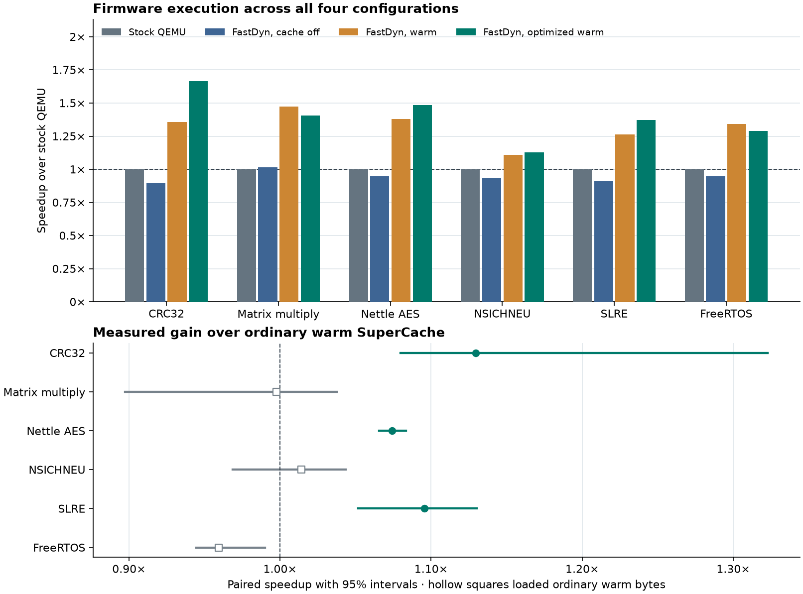

# Four-way warm SuperCache benchmark

Across six Cortex-M3 firmware workloads, the production-selected warm cache ran guest work **1.382× as fast as stock QEMU** (95% interval 1.347–1.406×) and **1.043× as fast as ordinary warm SuperCache** (1.021–1.077×). The complete FastDyn process took **3.69× as long as stock QEMU**. Cache selection had little effect on process wall time (1.002× ordinary warm, 0.993–1.010×).

| Speed relative to stock QEMU | Stock QEMU | FastDyn, cache off | Ordinary warm | Selected warm |
|---|---:|---:|---:|---:|
| Guest work | 1.000× | 0.942× | 1.316× | **1.382×** |
| Whole process | 1.000× | 0.269× | 0.272× | **0.271×** |

## Guest work

Each time is a median in milliseconds. The speedup and its interval come from the 24 within-block ordinary-warm/selected-warm ratios.

| Firmware | Stock QEMU | FastDyn, cache off | Ordinary warm | Selected warm | Selected vs. ordinary warm (95% CI) |
|---|---:|---:|---:|---:|---:|
| CRC32 | 2.578 | 2.856 | 1.919 | 1.550 | 1.129× [1.080, 1.323] |
| Matrix multiply | 2.907 | 2.869 | 2.008 | 2.130 | 0.998× [0.897, 1.038] |
| Nettle AES | 8.180 | 8.630 | 5.925 | 5.535 | 1.074× [1.065, 1.083] |
| NSICHNEU | 23.473 | 25.052 | 21.230 | 21.156 | 1.014× [0.969, 1.043] |
| SLRE | 9.309 | 10.138 | 7.389 | 6.668 | 1.096× [1.052, 1.130] |
| FreeRTOS | 6.874 | 7.191 | 5.190 | 5.334 | 0.959× [0.945, 0.990] |

The selector promoted `dominant-return` for CRC32 and `activation-layout` for Nettle AES and SLRE. All three improved guest time in these four-arm measurements. Matrix multiply, NSICHNEU and FreeRTOS retained the original warm cache, and both warm arms on each of those workloads loaded byte-identical cache and hint contents.

FreeRTOS took longer in the selected arm even on those identical bytes. It won 6 of 24 pairs, and both launch-order groups showed the same direction. The experiment did not isolate the source of this timing difference. All three fallback results above use elapsed measurements.

## Whole process

The wall clock covers startup through process exit. The three FastDyn arms include the Python frontend, QEMU launch and execution. Stock includes its direct QEMU launch and execution. The process timer starts after staging the RAM, image and any cache, and after verifying the selection receipt. Offline capture, training and optimization precede the timed campaign.

| Firmware | Stock QEMU | FastDyn, cache off | Ordinary warm | Selected warm | Selected vs. ordinary warm (95% CI) |
|---|---:|---:|---:|---:|---:|
| CRC32 | 96.368 | 377.747 | 371.865 | 369.428 | 1.015× [0.995, 1.028] |
| Matrix multiply | 95.271 | 370.456 | 368.591 | 367.029 | 1.012× [0.992, 1.031] |
| Nettle AES | 104.089 | 379.640 | 377.089 | 378.216 | 0.996× [0.989, 1.012] |
| NSICHNEU | 123.038 | 408.012 | 406.685 | 405.192 | 1.009× [0.987, 1.045] |
| SLRE | 106.979 | 376.864 | 376.675 | 383.425 | 0.986× [0.973, 1.003] |
| FreeRTOS | 100.904 | 387.749 | 384.283 | 385.185 | 0.997× [0.963, 1.016] |

## Builds and workload controls

Stock used Ubuntu 24.04's packaged QEMU 8.2.2 with TCG and the Netduino2 board. All three FastDyn arms shared the same integrated QEMU 10.0.50 binary, Cortex-M3 machine, FastDyn plugin, frontend and configuration, with SuperCache enabled in both warm arms. FastDyn used private file-backed RAM on tmpfs (`share=off`). Stock used the board's process-local SRAM. The host was an Apple M4 Pro with x86-64 Ubuntu under Rosetta. Measured processes ran serially on CPU 2.

FastDyn's plugin and frontend base came from `main` at `c81bbd4`. The frontend included the SuperCache changes. The QEMU build combined the SuperCache loader with main's six ordered QEMU patches. The indexed virtual-hook lookup applied to all six fixtures. The configs requested no guest fragments, MMIO replacements or constant-PC redirects. Main's plugin release preset used `-O0` and disabled development logging. The optimizer produced the candidates at `547e87f`. Deployment used scopt `120614f`. Source, tree, executable, plugin, firmware and cache identities are recorded in [provenance.json](provenance.json).

The five Embench fixtures used the same compiled workload object on both boards, with separate board and timer adapters. The four-byte input changes the value read before timing while preserving the fixed workload. The stock FreeRTOS image required six board-adapter edits spanning three branch hooks, two stack-top changes and one task argument. FreeRTOS uses fixed work without an input bank. Stock timed guest markers through semihosting at 1 GHz. FastDyn used its benchmark callbacks.

## Selection and timing

The candidate and ordinary warm cache first ran in 24 randomized calibration pairs per firmware. The production `select-warm` decision required a majority of wins, median paired speedup above 1 and a one-sided order-balanced randomization probability at or below 0.05. All six choices were frozen before the reported run. The five bank-backed fixtures used fresh input contents. Each fourth-arm launch deployed its choice through `scopt deploy --selection`.

We excluded one warmup block per firmware and ran all 24 permutations of the four arms once per firmware. This yielded **576 measured launches**, including 144 ordinary warm and 144 selected warm launches. Every launch returned the expected result. All 288 cache-enabled launches passed replay checks and appended zero translation records.

Each firmware's speedup is the median of the within-block reference/compared time ratios. The suite speedup gives every firmware equal weight by taking the geometric mean of the six paired medians. Pointwise and suite 95% intervals use 20,000 bootstrap resamples of paired blocks. The suite resamples independently within each fixed firmware and uses NumPy's default generator with seed 20261120. These intervals describe repeat measurements of the six workloads.

## Recheck the results

From this directory, run `python3 verify.py` in the scopt development environment. It checks the recorded permutations, decisions, cache identities, medians and per-firmware intervals. With NumPy installed it also checks the suite intervals.

- [Measured trials and replay identities](samples.csv) includes the 576 paired timings, return values, deployed identities and original receipt digests.
- [Calibration pairs](calibration.csv) contains the 144 two-arm pairs used by the production selector.
- [Per-firmware results](summary.csv) and [suite results](suite.json) contain all six pairwise comparisons for each timing scope.
- [Provenance](provenance.json) records the original archive digests and each firmware's warm, candidate and deployed cache hashes.
