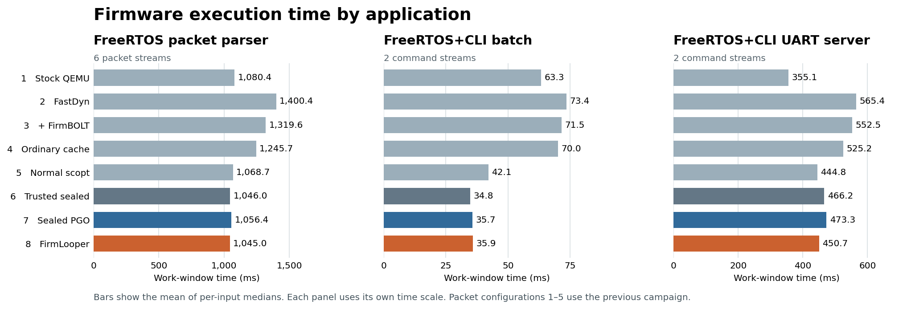

# Evaluating PGO-guided firmware inlining

Use an ordinary fixed-input training launch to find calls in observed cycles.
For configuration 7, scopt first counts native helper calls and splices eligible
roots. It then embeds eligible guest calls using the same training profile,
recursing into nested calls and keeping only regions the profit model admits
(results below predate the profit model and recursion). The default threshold for each kind of call is 1,000 observed
executions. Unselected functions remain shared. See the [pass catalog](../../docs/passes.md)
and [trusted PGO pipeline](../../docs/sealed-whopr-7.md).

## Seven configurations

| # | Configuration |
|---:|---|
| 1 | Upstream stock QEMU, original O0 guest |
| 2 | FastDyn QEMU, original O0 guest, cache off |
| 3 | FastDyn QEMU, FirmBOLT guest, cache off |
| 4 | Ordinary warm cache of the FirmBOLT guest |
| 5 | Normal scopt on the ordinary cache, using store forwarding and the B3 pipeline |
| 6 | Trusted sealed public cache of the FirmBOLT guest |
| 7 | Same trusted sealed capture with automatic hot-loop PGO |


Each bar is the arithmetic mean of the input medians for that application.
The packet parser ran six streams. The three `heldout` streams emphasized
key/value operations, text, and malformed packets. The three `final` streams
emphasized sensor data and longer binary payloads. These names come from the
original evaluation splits. All six contributed equally to the packet-parser
group. The CLI group gives equal weight to the mixed-command and help-heavy sessions.

Record the firmware work window in a fresh process for every arm. Build,
capture, profile, optimize, compile launches and stage inputs before scoring.
Stock uses the unmodified MPS2 board model and a start breakpoint plus
end-of-work polling. FastDyn uses the guest markers. In this comparison,
configurations 1–5 use shift-zero instruction counting. Configurations 6–7
use the sealed exact-PC execution mode without icount. Use the paired 6–7
comparison to measure the incremental effect of PGO. The speed relative to
stock includes differences in execution mode and board model.

## Procedure

Use a work and results directory outside both checkouts. Generate the ordinary
cache with the same QEMU executable used by all FastDyn arms. For the sealed
arms, capture the rewritten image again using the sealed-firmware preparation
tool. Compile the training launcher against that executable, plugin, cache
and training input. [Capture instructions](../../docs/qemu.md)

```sh
scopt optimize "$SNAP" --pipeline sealed-pgo-7 --pgo-launch "$BASE/launch.json" \
  --elf "$FIRMBOLT_ELF" --v7-trusted-exe "$QEMU_SHA256_ID" \
  --runtime-identity "$RUNTIME_JSON" --store "$OUT" --json > "$OUT/optimization.json"
```

Create `$OUT` before the command. Check the host and guest pass receipts for
executed sites. The underlying launch for arms 4–7 sets `QEMU_SC_TRUSTED=1`.
Arms 6 and 7 additionally set `QEMU_SC_SEALED=1`. Diagnose public cache
loading with the qprof loaded header and record count. In a separate replay
without qprof, use `QEMU_SC_V7_STATS` to verify that private regions activated
inside the work window (`benchmark_region_entries`, `benchmark_region_activations`)
and the integrity-check counters stayed at zero. Region exits through the
dispatcher are `trusted_residual_exits` (counters revision 2 and later);
`trusted_tb_calls` counts trusted-membership lookups, not exits
([counter definitions](../../docs/qemu.md#v7-dispatcher-return-counters)). Run timing without either diagnostic.

Configuration 6 lacks the guarded return chaining and specialization that the B3
pipeline gives configuration 5. Configuration 6 + B3 adds them to the same sealed
capture, so the sealed baseline includes everything normal scopt does. Store
forwarding does not apply, because sealed TBs have no icount entry. Collect a steady
profile on the sealed snapshot itself, then run the unchanged `b3` pipeline:

```sh
scopt profile run -c "$SEALED_CFG" --snapshot "$SNAP" --qemu "$Q" --sealed --trusted \
  --phase steady@0xMARKER --inputs "$TRAIN" --out "$OUT/prof-sealed"
scopt optimize "$SNAP" --pipeline b3 --store "$OUT" \
  --profile "$OUT/prof-sealed/merged.profile.json" --prep "$SEALED_PREP" \
  --elf "$FIRMBOLT_ELF" --enable specialize-returns --enable chain-returns \
  --enable chain-static --json > "$OUT/optimization-6b3.json"
```

Launch it like configuration 6. The QEMU must activate B3 on sealed lookups
(`docs/qemu.md`, "Sealed B3"). `QEMU_SC_V7_EXPERIMENT=no-sealed-sc6` gives the
old behaviour on the same bytes for attribution. [B3 on sealed captures](../../docs/b3-passes.md)
Configuration 7 + B3 composes B3 with configuration 7's trusted firmware regions in one
artifact: `--pipeline sealed-pgo-7-b3` (or `sealed-whopr-7-b3`) with the same sealed profile,
`--prep`, `--enable` flags and `--v7-trusted-exe`. Give configurations 7 and 7 + B3 the same
explicit sealed steady profile so that region selection does not confound the B3 effect.
With `QEMU_SC_V7_STATS`, check `"sc6_composed": true` and that `regions_loaded` equals
configuration 7's count.

The packet-parser evaluation uses six distinct existing streams and checks the
parser model and output registers. FreeRTOS+CLI uses the upstream command
interpreter and sample handlers on the Cortex-M3 FreeRTOS port. A RAM-backed
command task drives a separate training session and two scored sessions
covering fixed- and variable-argument echo, help, missing arguments, and
unknown commands. Compare command count, reply count and output-byte summaries
against upstream QEMU for each input. Record any unexecuted region separately.
Randomize the order within each paired block and retain per-input medians.

Keep input files, eval firmware, caches, logs, counters, timing observations
and generated reports in the external results directory. The
[paired timing utility](measure.py) can also compare two prepared FreeRTOS
caches with private RAM mappings. It stages a third bundle of the snapshot cache,
`ordinary-aa`, as the A/A noise-floor control, and refuses fewer than 8 pairs unless
`--allow-few-blocks` is given. `pairs/results.json` keeps the legacy
`paired_speedups`, `median_paired_speedup` and `bootstrap_95` and adds `noise_floor`
and `comparison` (median, interval, sign test and `verdict`).

## FirmLooper compared with PGO

FirmLooper is a separate eighth configuration. It selects guest calls in
structurally persistent task loops and recursively expands eligible captured
callees. It uses the same sealed capture and trusted execution mode as
configurations 6 and 7. The PGO selector still uses an ordinary training launch.
Both policies were compiled with the corrected region builder and return linker.
[Policy definitions and reproduction command](../../docs/firmware-inline-policies.md)



| Firmware workload | Inputs × paired blocks | PGO / FirmLooper, median paired speedup (95% interval) | Sealed / FirmLooper |
|---|---:|---:|---:|
| FreeRTOS packet parser | 6 × 6 | 1.018× (0.999–1.030) | 1.003× (0.977–1.024) |
| FreeRTOS+CLI finite batch | 2 × 8 | 1.021× (0.967–1.035) | 0.989× (0.945–1.019) |
| FreeRTOS+CLI persistent UART server | 2 × 8 | 1.042× (0.992–1.076) | 1.039× (0.996–1.059) |

Each process ran one fixed input. Ratios use the summed times across inputs
in each randomized block, followed by the median across blocks. Intervals
resample whole blocks. The chart shows the mean of individual input medians.
Both CLI panels use fresh timings for all eight arms. The packet panel uses
the previous campaign's arms 1–5 and fresh, interleaved timings for arms 6–8.
Only arms 6–8 share the sealed execution contract. Build, capture, optimization,
launch preparation, process startup and diagnostic replays are outside the timer.

* **Packet parser.** FreeRTOS starts a persistent processing task and a finite
  receive task. FirmLooper emitted 30 regions and PGO emitted 9. Single-input
  diagnostic replay identified 29 active FirmLooper roots in the processing and
  timer tasks. PGO entered all 9 of its roots, including calls in the finite receive
  task. The two active sets had no captured root in common. FirmLooper emitted
  395,934 private native bytes and PGO emitted 79,301. Both completed the same
  work on all six streams. The application-wide timing interval includes parity.
* **Finite batch CLI.** The command loop exits when the batch ends. FirmLooper
  emitted two other task regions and entered neither during measured work.
  Its timing does not measure a benefit from inlining the command loop.
* **Persistent UART server.** The upstream FreeRTOS+CLI UART task waits for
  characters, handles commands, and resumes waiting. A RAM serial adapter sent
  6,000 mixed commands or 4,000 help-heavy commands. All 16 output words matched
  upstream QEMU on both sessions. FirmLooper emitted 14 regions to depth 5
  (171,614 native bytes) and activated 8 during each work window. PGO emitted
  7 regions to depth 1 (126,478 bytes) and activated 5. Mixed commands alone
  gave 1.037× (1.004–1.088), while help-heavy commands gave 1.024×
  (0.967–1.051). FirmLooper's compile wall times on these sealed CLI snapshots
  were 20 s for the batch and 23 s for UART. PGO took 137 s and 157 s respectively,
  including automatic training. These were single setup observations.

An initial packet build processed 184 of 28,560 expected packets. The guest
`BL` at `0x19650` was present in a fallback translation omitted from call-site
discovery. The region builder treated it as a branch. Its callee returned to
`0x1a902` instead of `0x19654`. The repaired builder keeps unverified calls
public, follows nested continuations in their enclosing context, and the linker
preserves the original lookup on a return-guard miss. The invalid timing was
discarded. The triggering stream became a development case for this repair.

FirmLooper remains opt-in. It found and exercised substantially different code
from PGO. Across these three workloads the application-level intervals include
1.0. A further comparison can use independent task workloads with a larger share
of execution in those admitted regions.

The subsequent profile-free RTOS experiments compare nine configurations,
isolate guest layout and inlining, and test how far to follow application
calls below a task loop. [Per-application results and reproduction](rtos/README.md)
