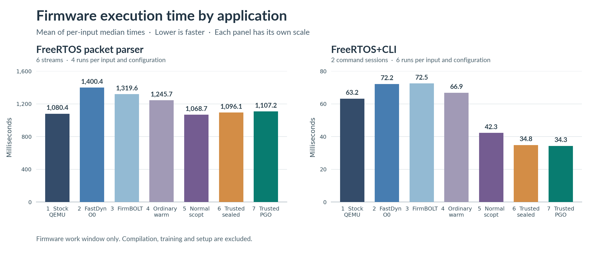

# Evaluating PGO-guided firmware inlining

Use an ordinary fixed-input training launch to find calls in observed cycles.
For configuration 7, scopt first counts native helper calls and splices eligible
roots. It then embeds one callee layer at eligible guest calls using the same
training profile. The default threshold for each kind of call is 1,000 observed
executions. Unselected functions remain shared. See the [pass catalog](../../docs/passes.md)
and [trusted PGO pipeline](../../docs/sealed-whopr-7.md).

## Seven configurations

| # | Configuration |
|---:|---|
| 1 | Upstream stock QEMU, original O0 guest |
| 2 | FastDyn QEMU, original O0 guest, cache off |
| 3 | FastDyn QEMU, FirmBOLT guest, cache off |
| 4 | Ordinary warm cache of the FirmBOLT guest |
| 5 | Normal scopt on the ordinary cache, using store forwarding and the B3 pipeline |
| 6 | Trusted sealed public cache of the FirmBOLT guest |
| 7 | Same trusted sealed capture with automatic hot-loop PGO |



Each bar is the arithmetic mean of the input medians for that application.
The packet parser ran six streams. The three `heldout` streams emphasized
key/value operations, text, and malformed packets. The three `final` streams
emphasized sensor data and longer binary payloads. These names come from the
original evaluation splits. All six contributed equally to the packet-parser
group. The CLI group gives equal weight to the mixed-command and help-heavy sessions.

Record the firmware work window in a fresh process for every arm. Build,
capture, profile, optimize, compile launches and stage inputs before scoring.
Stock uses the unmodified MPS2 board model and a start breakpoint plus
end-of-work polling. FastDyn uses the guest markers. In this comparison,
configurations 1–5 use shift-zero instruction counting. Configurations 6–7
use the sealed exact-PC execution mode without icount. Use the paired 6–7
comparison to measure the incremental effect of PGO. The speed relative to
stock includes differences in execution mode and board model.

## Procedure

Use a work and results directory outside both checkouts. Generate the ordinary
cache with the same QEMU executable used by all FastDyn arms. For the sealed
arms, capture the rewritten image again using the sealed-firmware preparation
tool. Compile the training launcher against that executable, plugin, cache
and training input. [Capture instructions](../../docs/qemu.md)

```sh
scopt optimize "$SNAP" --pipeline sealed-pgo-7 --pgo-launch "$BASE/launch.json" \
  --elf "$FIRMBOLT_ELF" --v7-trusted-exe "$QEMU_SHA256_ID" \
  --runtime-identity "$RUNTIME_JSON" --store "$OUT" --json > "$OUT/optimization.json"
```

Create `$OUT` before the command. Check the host and guest pass receipts for
executed sites. The underlying launch for arms 4–7 sets `QEMU_SC_TRUSTED=1`.
Arms 6 and 7 additionally set `QEMU_SC_SEALED=1`. Diagnose public cache
loading with the qprof loaded header and record count. In a separate replay
without qprof, use `QEMU_SC_V7_STATS` to verify that private regions activated
inside the work window and the integrity-check counters stayed at zero.
Run timing without either diagnostic.

The packet-parser evaluation uses six distinct existing streams and checks the
parser model and output registers. FreeRTOS+CLI uses the upstream command
interpreter and sample handlers on the Cortex-M3 FreeRTOS port. A RAM-backed
command task drives a separate training session and two scored sessions
covering fixed- and variable-argument echo, help, missing arguments, and
unknown commands. Compare command count, reply count and output-byte summaries
against upstream QEMU for each input. Record any unexecuted region separately.
Randomize the order within each paired block and retain per-input medians.

Keep input files, eval firmware, caches, logs, counters, timing observations
and generated reports in the external results directory. The
[paired timing utility](measure.py) can also compare two prepared FreeRTOS
caches with private RAM mappings.
