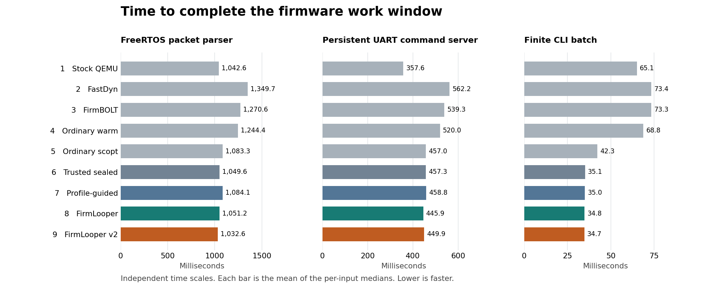

# Task-directed optimization on FreeRTOS Cortex-M3

On the FreeRTOS packet parser, allowing FirmBOLT to consider leaf calls one application-call layer below a task loop improved guest execution by **1.058×** relative to selecting only direct calls in the loop (95% paired bootstrap interval 1.041–1.092×). On an independently seeded packet stream the ratio was **1.046×** (1.034–1.113×). The wider policy reached a checksum in the packet worker. This result is for an ordinary FastDyn execution window with guest instruction accounting enabled.

## Nine matched reference configurations

Mean of the per-input median work-window times in milliseconds. Each application has its own axis. Only rows 6–9 share the trusted sealed execution contract. Rows 3–9 use the earlier profile-rewritten guest. FirmLooper's SCOPT selector uses no execution profile. The separate guest experiment below also removes the need for a guest training profile.



| Configuration | Packet parser | UART command server | Finite CLI batch |
|---|---:|---:|---:|
| 1. Stock QEMU | 1042.6 | 357.6 | 65.1 |
| 2. FastDyn | 1349.7 | 562.2 | 73.4 |
| 3. FastDyn + FirmBOLT | 1270.6 | 539.3 | 73.3 |
| 4. Ordinary warm cache | 1244.4 | 520.0 | 68.8 |
| 5. Ordinary scopt | 1083.3 | 457.0 | 42.3 |
| 6. Trusted sealed | 1049.6 | 457.3 | 35.1 |
| 7. Sealed profile-guided inlining | 1084.1 | 458.8 | 35.0 |
| 8. Sealed FirmLooper, closed loops | 1051.2 | 445.9 | 34.8 |
| 9. Sealed FirmLooper v2, RTOS boundaries | 1032.6 | 449.9 | 34.7 |

Paired ratios are calculated separately from the bar heights. Each block sums each arm's times across inputs, divides reference by candidate, and contributes one ratio. Intervals resample whole blocks.

| Comparison with v2 | Packet | UART | Batch |
|---|---|---|---|
| Sealed / v2 | 1.014× (0.986–1.031) | 1.002× (0.983–1.017) | 1.020× (1.003–1.052) |
| PGO / v2 | 1.040× (1.024–1.073) | 1.017× (0.983–1.049) | 0.992× (0.978–1.048) |
| FirmLooper / v2 | 0.993× (0.986–1.040) | 0.985× (0.968–1.010) | 0.999× (0.985–1.025) |

V2 emitted 10, 16 and 1 regions for packet, UART and batch respectively. Separate runtime diagnostics on one input per workload saw 4, 5 and 0 region activations inside the work windows. The batch command loop is finite and its sole private region stayed inactive. Its measured difference from sealed cannot be attributed to executing inlined code. A fresh command stream gave UART v2 1.040× versus FirmLooper (1.001–1.051). The original scored inputs did not establish that advantage.

Tests exposed a kernel-boundary false positive. The FreeRTOS+CLI application dispatcher shares a naming prefix with FreeRTOS. Correcting the classifier admitted its call in two captured contexts and activated one extra region. Paired replay of the two UART artifacts measured 1.005× (0.955–1.051) from the correction.

## Profile-free FirmBOLT guest ablations

The input is the original ELF for each application. All four rewritten arms use the same static plan, relocation and immutable-literal materialization. The control applies neither experimental switch. These times came from a separate interleaved campaign.

| Guest on ordinary FastDyn | Packet, ms | UART, ms | Batch, ms |
|---|---:|---:|---:|
| Original | 1417.7 | 581.3 | 80.0 |
| Matched rewrite control | 1439.0 | 577.0 | 80.2 |
| Loop-scoped strict-leaf inlining | 1443.9 | 584.2 | 80.5 |
| Semantic TB-page and ExtTSP layout | 1442.1 | 582.7 | 80.4 |
| Inlining and layout | 1457.1 | 599.7 | 79.7 |

* **Packet.** Only one leaf qualified directly in a selected loop. Its original call and private copy both executed zero times on the diagnostic stream. The call to the packet handler did execute 13,664 times. Allowing leaf calls inside that handler admitted 33 static call sites. On the diagnostic stream, its copied checksum ran 12,740 times. On the fresh stream it ran 13,202 times. The checksum call in the monitor task remained inactive. The one-layer switch changes the shared guest helper, so other callers of that helper can also execute the new code. The gain covers the full set of accepted sites.
* **UART.** The three inlined calls to `strlen` executed 6,000, 21,768 and 6,000 times. The original and cloned entry counts agree exactly on the commands input. Inlining alone gave 0.993× (0.950–1.041). Combining it with layout gave 0.977× (0.967–0.999) on the two original inputs and 0.994× (0.951–1.093) on a fresh stream.
* **Batch.** Zero leaf calls qualified. The combined guest arm gave 1.004× (0.979–1.034) versus its control.

| Packet guest, one caller layer | Rewrite control, ms | Direct loop leaves, ms | One application-call layer, ms |
|---|---:|---:|---:|
| Development stream | 2234.8 | 2176.1 | 2095.7 |
| Fresh stream, seed 699307 | 2179.6 | 2229.3 | 2099.9 |

The 48 timed replays matched all 16 result words. In this eight-block comparison the original direct-loop policy gave 1.001× (0.986–1.008) versus control, and the one-layer policy gave 1.066× (1.041–1.071). Use the latter as an opt-in packet-parser policy. Only one application has supplied independent timing evidence for this extension. Six separate paired preparation samples measured a median incremental plan-and-rewrite cost of 29 ms for the extra layer. Against the measured paired saving of 103 ms per input, that cost is recovered in one replay in the guest-only campaign.

## Sealed guest and host interaction

Each guest ELF received its own sealed capture. Both plain and optimized caches were validated in separate runtime replays. The guest columns below use the direct-loop policy.

| Sealed work window, ms | Packet | UART | Batch |
|---|---:|---:|---:|
| Guest rewrite control | 1179.4 | 516.6 | 38.3 |
| Control + host FirmLooper v2 | 1168.0 | 515.3 | 38.3 |
| Guest inlining and layout | 1112.4 | 505.7 | 39.2 |
| Guest inlining and layout + host v2 | 1123.0 | 521.9 | 38.5 |

On the packet parser the two guest switches together gave 1.057× (1.038–1.070) over the matched sealed control. Adding host v2 to that guest gave 0.999× (0.959–1.010). An additional stream with separate matching caches gave 1.003× (0.969–1.032) for guest inlining alone, 1.112× (0.681–1.137) for layout alone, and 1.084× (1.044–1.143) for both. Those results support a gain for the combination. The wide layout-only interval limits attribution to a single pass.

We also captured both deep-policy images separately and tested the same two packet streams as the 48-run guest experiment. Eight paired blocks measured 1108.8 ms for the sealed guest control, 1027.2 ms for one-layer guest inlining, 1019.6 ms for one-layer guest inlining with layout, and 1017.0 ms after also applying host v2. The full pipeline gave **1.085×** (1.060–1.122) versus control. Given an already inlined and laid-out guest, adding host v2 gave **0.977×** (0.968–1.041). The sealed gain is attributable to the guest changes at the resolution of this experiment. One-layer inlining alone gave 1.072× (1.047–1.111). Against the shallower *combined* guest, the deeper combined guest gave 0.989× (0.981–1.041).

The initial batch capture rejected a replay at PC `0xd36` in `xTaskIncrementTick`. The exhaustive coverage sweep uses thread context `cs_base=0x800400`. This replay reached the pended-tick path in handler context `0x800401`. It failed closed even with plain sealed execution. The batch numbers above use a new capture for each guest with three additional training sessions, each repeating the original training commands up to 900 KB. The scored inputs and interrupt settings were identical across arms. The archive retains the failed trial. Interrupt contexts beyond those captured can still miss.

## Syscall specialization

FirmBOLT's build-assisted prototype specializes the existing FreeRTOS `xQueueGenericSend` body when the compiler proves zero wait. The second variant also requires send-to-back. Normal waiters, wakeups, preemption, hooks and locking remain in the kernel implementation. On a separately rebuilt UART firmware with `-Os`, the specialized entries executed 187,458 times on the commands input. Binding the second argument fact reduced the clone from 448 to 408 Thumb bytes. The paired ratios against the matched ordinary build were **0.989×** (0.956–1.004) for zero wait and **0.988×** (0.975–1.006) for both facts. Keep both opt-in. The object analysis records creation and handle flow. Stronger syscall transformations still need proof about concurrent access, ISR waiters and scheduler state. [Source specializer and reproduction](https://github.com/boardrunner2049/firmbolt/tree/treb-wip/tools/rtos-specialize)

## Measurement and reproduction

The nine-arm panel used six packet streams × six blocks and two inputs × eight blocks for each CLI workload. Each observation starts a fresh QEMU process pinned to the application's assigned CPU on a Xeon w5-3435X running Linux 6.17.0-1033-oem. Arm order was randomized within each block. Simultaneous campaigns and host load can affect absolute times. Compare paired arms within a campaign. The finite CLI and persistent UART task share upstream FreeRTOS+CLI code and exercise different control flow. Results apply to these applications and builds.

FastDyn measures from the guest start marker to the completion marker. Stock QEMU uses its GDB stub with a removed start breakpoint and sparse end polling. Timing excludes preparation, compilation, process launch, boot and diagnostic replay. The ordinary runs enable instruction accounting. Trusted sealed runs use no icount, public interrupt polling and the opt-in private-region contract. No timing here establishes behavior for interrupt-sensitive private code. The 16 reported words check application work. Stock independently checks all 16 for CLI and 15 derivable fields for the packet workload. The remaining packet word is checked against the unmodified FastDyn transcript. Comparisons between stock, ordinary and sealed include their different observation contracts.

The initial guest rewrite failed FirmBOLT's observable-address check on an immutable Thumb literal. Applying the existing literal materialization option to **every** guest arm, including control, allowed all three applications to publish. Earlier times from rejected images are excluded. Boot timing and break-even including offline sealed capture and optimization are unmeasured.

The shared evaluation archive contains the per-input plans, raw observations, failed runs, exact kernel/tool revisions, source overlays and fixture build scripts. Its `fixtures/README.md` includes CLI rebuilds for FreeRTOS kernel `89592801dd8b` with Arm GCC 13.3.1, and `fixtures/packet-parser` contains the packet image and inputs. Pinned executable cache bindings must be regenerated on a different host.

From the FastDyn checkout, point `QEMU` at the matching built QEMU, add the FastDyn CLI to `PATH`, and install the checkout's scopt into the selected Python environment. Set `FASTDYN`, `FIRMBOLT`, `ELF`, `TRAIN`, `OUT` and `SCOPT_ENVLAYOUT_PATH` to the local source trees, original input ELF, training input, destination and matching environment metadata. Use `LD_LIBRARY_PATH` appropriate to the plugin build.

```sh
export PYTHONPATH="$FIRMBOLT/src:$FASTDYN/tools/scopt:$FASTDYN/src"
E="$FASTDYN/tools/scopt/experiments/hot-loop-inline"
python -m firmbolt.task_profile "$ELF" "$OUT/plan"
# Use --inline-callee-depth 1 on the preceding command for the one-layer variant.
"$FIRMBOLT/bin/firmbolt" --cpu cortex-m3 "$ELF" -o "$OUT/combined.elf" \
  --task-loop-plan "$OUT/plan/plan.json" --task-loop-inline --task-loop-layout \
  --report "$OUT/combined.json" --new-code-address 0x10000 -- \
  --firmbolt-materialize-literals --firmbolt-materialize-literals-min-count=0 \
  --firmbolt-materialize-literals-max-function-size=0 \
  --skip-funcs=vComputeWindowStart,vComputeReport1,vComputeReport2,vComputeReport3,vComputeReport4,vComputeDone
python "$E/prepare_rtos.py" "$OUT/combined.elf" "$OUT/ordinary" --qemu "$QEMU"
python "$E/prepare_rtos.py" "$OUT/combined.elf" "$OUT/sealed" --qemu "$QEMU" --sealed-training-input "$TRAIN"
scopt optimize "$OUT"/sealed/store/snapshots/* --pipeline sealed-firmlooper-v2 \
  --elf "$OUT/combined.elf" --runtime-identity "$OUT/sealed/runtime.json" \
  --v7-trusted-exe "$(jq -r .qemu_sha256 "$OUT/sealed/runtime.json")" \
  --store "$OUT/v2" --json > "$OUT/v2.json"
python "$E/compare_rtos.py" "$PLAN" "$OUT/timings"
```

Use a separate output directory per ELF. Remove either or both of the guest switches to reproduce each ablation. Use `sealed-firmlooper` for the older policy. The optional repeated `--sealed-training-input` flag records additional contexts. The optimizer receipt lists each emission, residual call, rejection, overlap and source identity as applicable. The replay driver checks loaded cache headers, private artifact IDs, output words, clean warm execution, and immutable cache extent. It records raw process observations and whole-block bootstrap intervals.

A replay plan is JSON. Give it `application` (`packet`, `uart` or `batch`), a CPU number, RNG seed, block count, input cases, named arms and pairs of arm names to compare. Each case supplies an input path and its 16 expected output words. Alternatively give the plan an `oracle_launch` for the original uncached FastDyn guest to generate those words. A stock arm supplies `stock` pointing to the original ELF. Other arms supply the compiled `launch.json` under `launch`. Cached arms also supply `cache`, and trusted sealed arms set `sealed` to true. Working per-application plans in the evaluation archive include all nine configurations. [Policy rules and plugin interface](../../../docs/firmware-inline-policies.md) · [FirmBOLT options and examples](https://github.com/boardrunner2049/firmbolt/blob/treb-wip/docs/passes.md)
