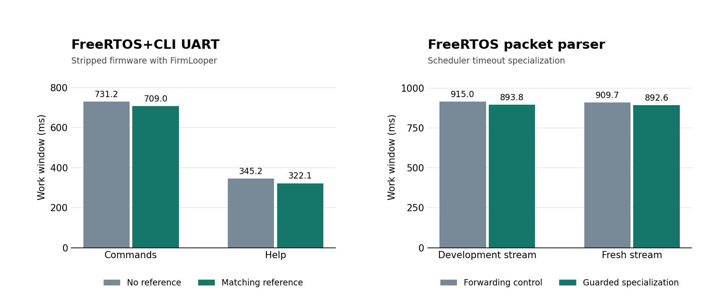

# FreeRTOS signature recovery and kernel specialization

A symbolized reference can recover service names in stripped firmware. The recovered name identifies an opportunity. Checked source arguments, object invariants and final linking determine whether a kernel specialization is valid. The guest and host experiments measure these mechanisms separately.

## How much did signature matching recover?

| Reference → stripped UART target | Correct names and entries | Extent and policy outcome |
|---|---:|---|
| Same `-Os` load image | 237 / 237 | Matched companion restored the original boundaries and four task entries. |
| `-Os` → independently linked, changed `-Os` build | 28 / 238 | All 28 matched the withheld symbols and sizes. One required normalizing a direct call displacement and verifying the destination. |
| `-Os` → different compiler/build at `-O0` | 4 / 266 | All four starts and names agreed. Two matched spans ended two bytes before the true end. No complete task loop recovered. |

The cross-build path requires distinguishable Thumb bytes and independent evidence of an entry in the target. Direct calls to identifiable reference functions must still lead to matching targets. Unresolved candidates remain visible in the receipt. Cross-build matches are hints and can miss functions or underestimate extent. They cannot establish ABI compatibility, queue ownership or the absence of an interrupt.

A separate live test captured the **stripped** `-O0` UART guest. Without a reference the policy emitted zero regions. With its matching `-O0` companion it emitted 22, with seven activated during each input. On two workloads and six paired blocks, FirmLooper with recovery ran **1.036×** faster (95% paired bootstrap **1.014–1.080×**). This measures what enabling inlining did to execution. Matching itself runs offline. All 24 scored runs agreed on the 16 output words. [Matcher commands, contracts and examples](../../../../docs/firmware-inline-policies.md)

## Beyond queue send

FirmBOLT's build-assisted generator supports explicit rules across notifications and scheduling, timers, event groups, stream/message buffers, mutexes, queues, co-routines and heap allocation. A rule can bind multiple typed constants; supported private services can also guard a runtime value and take the ordinary kernel path on a miss. The clone uses the existing FreeRTOS service implementation and preserves tracing, scheduler, list and wakeup effects. A correctness fixture executed all 13 static rules, plus separate tests for the guarded scheduler variant. It checked real payloads, events, timeouts and a higher-priority receiver waking. These checks supply no application performance figure.

Automatic discovery can also nominate rules outside the presets. Given a selected public API and its declaration, the tool checks the reference ELF's DWARF ABI, recovers the target entry, and reads constant register arguments at direct call sites. By default it considers supported register-passed scalar parameters. A user can also select particular parameters. It outputs a rules file for the generator. On the stripped packet image it found 40- and 92-byte heap allocations, notification action 2, and timer commands 1 and 3 without supplying those values. Two allocation sites had unknown sizes. All five generated clones executed. The two-input comparison gave 0.999× (0.986–1.027) versus the ordinary kernel and 0.964× (0.922–0.998) versus forwarding. Keep discovery for identifying candidates; select profitable rules by measurement.

The following comparisons use real FreeRTOS firmware built for Cortex-M3 at `-Os`. A forwarding control selects the same call sites while retaining the ordinary service body. Ratios above 1 favor the candidate.

| Experiment on packet firmware | What ran or changed | Native work-window result |
|---|---|---|
| Task notification and timer command constants | Notification-give clone executed 111 and 114 times on the two streams. Timer start and stop executed once each. The notification-poll clone was inactive. | Ordinary/candidate 1.023× (1.011–1.068), forwarding/candidate **0.998× (0.966–1.027)**. The controls do not establish a gain from the bound arguments. |
| Private scheduler helper with “may block indefinitely” fixed | Specialized delayed-list insertion ran 32,132 and 33,045 times. Its local instruction and translation-block counts fell. | Forwarding/candidate 0.962× (0.951–0.980). After matching code and data addresses, **1.006× (0.964–1.031)**. The initial regression was sensitive to placement. |
| Private scheduler helper with the actual infinite timeout checked | 116-byte specialized body versus 180 generic. 32,525 hits on development, 32,604 on a fresh stream. Finite waits retain the generic path. | Ordinary/candidate **1.037× (0.997–1.064)**. Forwarding/candidate 1.023× (0.975–1.054). |
| Timer population specialized for periodic expiry | Static recovery found the constructor's mode in r2. The source rebuild and final ELF qualification exclude incompatible constructor/setter calls. The expiry routine shrank from 64 to 44 Thumb bytes. | Eight blocks including a fresh stream gave ordinary/candidate **1.014× (0.688–1.080)**. Host load varied substantially. The candidate executed 1,651 callbacks versus 1,652 in its control on the independent input; the workload permits tick-dependent counts to differ. |
| Timer-owned active list head removal | Both private active lists are sorted; the timer daemon reads the first element without advancing the iteration cursor. The specializer uses that object role for expiry and retains ordinary removal for other lists or incompatible hook configurations. | Specialized helper 22 bytes versus 30 generic. Ordinary/candidate **1.012× (0.998–1.026)**, forwarding/candidate 1.019× (1.004–1.050). All 72 work windows matched their oracle. |

On the packet training input, observed TB executions at attributed function entries counted 929,610 in the port, 401,115 in queues/semaphores/mutexes, 296,053 in tasks, 75,182 in lists, 7,108 in timers and 14 in the heap. The event, stream and co-routine modules had no attributed standalone entry in this image. Their correctness results come from the dedicated fixture. No port specialization was measured. Counts guide site selection; they are neither host-cycle measurements nor evidence that an interrupt, waiter or lock is unnecessary. [Module inventory](../../../../docs/rtos-instance-analysis.md) · [Rule descriptions and reproduction](https://github.com/boardrunner2049/firmbolt/blob/treb-wip/tools/rtos-specialize/SERVICES.md) · [Timer-mode contract](https://github.com/boardrunner2049/firmbolt/blob/treb-wip/tools/rtos-specialize/timer-mode.md) · [Active-list contract](https://github.com/boardrunner2049/firmbolt/blob/treb-wip/tools/rtos-specialize/timer-list.md)

## Seven packet configurations

Milliseconds, lower is faster. Each cell is the mean of two per-input process medians, from six interleaved blocks. Each row had its own guest and matching captures. Rows ran on different cores or at different times. Cross-row absolute values are descriptive; use the dedicated same-core source and sealed comparisons for attribution. The guarded-scheduler panel briefly shared a core with another launch during its early measurements.

| Kernel build | 1 Stock QEMU | 2 FastDyn | 3 FirmBOLT | 4 Ordinary warm | 5 Ordinary scopt | 6 Trusted sealed | 7 Sealed PGO |
|---|---:|---:|---:|---:|---:|---:|---:|
| Ordinary | 734.2 | 937.5 | 868.5 | 875.8 | 652.5 | 751.6 | 732.2 |
| Notification + timer rules | 738.5 | 930.1 | 867.7 | 878.9 | 653.9 | 717.0 | 705.3 |
| Scheduler flag fixed | 747.7 | 968.9 | 897.6 | 901.6 | 655.4 | 735.8 | 711.4 |
| Scheduler timeout guarded | 802.2 | 1120.1 | 1151.8 | 893.1 | 837.2 | 918.5 | 744.2 |
| Periodic timer population | 718.3 | 911.6 | 877.2 | 866.2 | 660.5 | 704.3 | 699.4 |

The separate same-core crossover interleaved the ordinary and three source-specialized builds in configurations 6 and 7 on the same two packet streams. All **128** scored runs passed. Against the ordinary kernel in configuration 6, notification+timer gave **1.038× (1.009–1.084)** and guarded scheduler gave **1.047× (1.018–1.059)**. With PGO (configuration 7), the respective ratios were **1.042× (1.0002–1.088)** and **1.024× (1.010–1.050)**. These are measured advantages for the rebuilt sealed pipelines on those inputs. Each guest image changed downstream layout and translation, and this crossover had no forwarding-control arm. It cannot isolate the benefit of a removed kernel branch. Keep the transformations opt-in.

An additional same-core **sealed forwarding-control** comparison isolated what the selected bodies contribute. For the guarded infinite-timeout scheduler, forwarding took 739.2 ms and the specialized implementation took 714.8 ms, for a paired **1.028× (1.011–1.058)**. The fixed scheduler flag alone gave 1.024× (0.957–1.065). Notification and timer constants together gave **0.990× (0.956–0.997)**. All 96 control and specialized replays passed. The guarded scheduler path warrants an opt-in recommendation for this sealed packet workload. The notification-and-timer bundle does not.

Repeating the forwarding comparison with sealed PGO (configuration 7) gave 1.022× (0.9994–1.046) for the guarded scheduler, 1.029× (1.010–1.031) for the fixed flag and 0.993× (0.987–1.026) for the notification and timer bundle. All 96 scored replays passed. On a fresh packet stream (seed 62501713), the guarded scheduler confirmed **1.037× (1.006–1.050)** in configuration 6. Configuration 7 gave **1.013× (0.985–1.032)** on the same fresh stream. The scoped recommendation is to use the guard for the plain sealed packet configuration.

Each run timed the application work window. Build, reference matching, guest profile/rewrite, capture, cache optimization, process setup, boot and diagnostic tracing were excluded. The ordinary rows use instruction accounting. Trusted sealed rows use their separate private-execution contract. Every rewritten guest had its own cache; diagnostic replays checked the loaded identities and outputs. Seven functions that failed FirmBOLT's literal-range checks were preserved at their input locations across matched guest builds. The archive retains the refusals. The unchanged runtime adds no per-block authentication. [Timing driver and methodology](../README.md)
