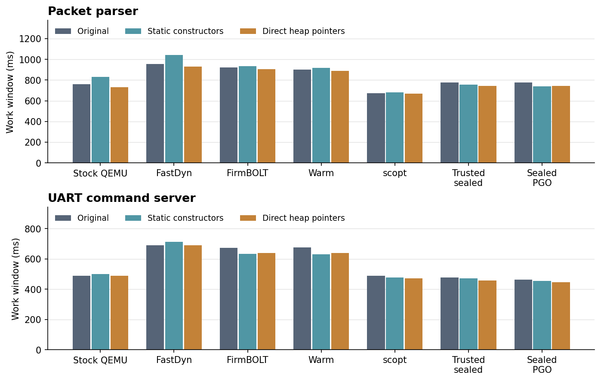

# Constant heap pointers for permanent allocations

This report measures firmware rebuilt from generated sources. For the later experiment that starts with the original linked packet and UART ELFs, see [FirmBOLT's binary allocation passes and seven-configuration results](https://github.com/boardrunner2049/firmbolt/blob/treb-wip/docs/rtos-elf/heap.md).

FirmBOLT's installed `firmbolt heap-tail` command substitutes compile-time addresses for selected allocation results while building the firmware. The original dynamic creation routines still initialize the objects. FastDyn captures and runs each resulting image. Building the ordinary and static-constructor versions separately provides two controls. [FirmBOLT command, examples and eligibility](https://github.com/boardrunner2049/firmbolt/blob/82ae4d4/tools/rtos-specialize/heap-tail.md)

Each site requires a fixed size and alignment, at most one creation per firmware lifetime, and no subsequent free, including on error paths. Ordinary kernel allocation flags and delete behavior are retained, so a later free would violate this policy's contract. Giving selected objects addresses unconditionally also changes exhaustion, allocator instrumentation and address observations. Slots have no firmware-resident allocation headers, lookup table, claim bits, or added selection guards. Existing object state, bounds checks and RTOS initialization stay in the original dynamic path. Unselected allocations continue to use heap_4 within the shortened prefix.

## Packet parser

Four queues, a mutex, a timer and four tasks occupy 14 slots because every task has a separate stack and control block. The linked 102,400-byte `ucHeap` starts at 0x20000420. Heap_4 manages the first 95,280 bytes, followed by a 7,120-byte reservation beginning at 0x20017850. A stock QEMU debugger read the queue, mutex and timer handles and the four ready-list TCBs and their stack pointers. All fourteen matched distinct aligned slots. A diagnostic firmware created and deleted an additional dynamic queue, allocated and wrote 95,256 bytes until the ordinary allocator had zero free bytes, and freed them again. Every reserved byte matched its saved copy and normal free space returned to 95,272 bytes. Both packet inputs still matched all sixteen result words.

| Packet measurement | Original | Static constructors | Direct heap pointers |
|---|---:|---:|---:|
| Reset handler to scheduler entry, ms | 1.870 | 1.579 | 1.808 |
| Application initialization to scheduler entry, ms | 1.765 | 1.468 | 1.704 |
| Four queue registrations, ms | 0.480 | 0.238 | 0.349 |
| Linked text, bytes | 14,360 | 13,828 | 14,340 |
| Linked BSS, bytes | 110,868 | 15,553 | 110,860 |
| Allocation calls on the measured input | 14 | 0 | 0 |

Direct pointers improved reset-to-scheduler **1.030× (95% paired interval 1.022–1.038)** versus ordinary. The constructor version retained the shortest boot. Cold initialization translated 188 TBs for ordinary, 151 for constructors and 184 for direct pointers. The site-specific dynamic routines still copy common initialization code; the four direct queue sites translated 47 TBs compared with 28 for the static constructors. The source contract explicitly keeps the full heap array in the direct build. The static-constructor build lets the linker discard it on this application.

In the ordinary guest at 0x114a, `xQueueGenericCreate` executes `bl pvPortMalloc`. The free-queue direct clone instead loads the literal 0x20017420 and adds 0x430 to obtain 0x20017850. It calls `prvInitialiseNewQueue` and returns the same constant address. Ordinary allocation checks that remain in a clone are still compiled in the normal way. In configuration 3 and later, FirmBOLT's relocation checks retained the input locations of four generated queue functions. These sites still ran in their direct-pointer form.

## UART command server

The four persistent command-list nodes use separate eight-byte slots inside the original 102,400-byte heap. The unadjusted direct build reported 98,048 free bytes to `query-heap`, compared with 98,016 in the ordinary application. For the timed direct build, the plan reserves a further 32 bytes of unused space in the tail. This restored the exact original query response without adding runtime metadata or changing the array extent. The matched static-constructor control uses the previously qualified 64-byte heap-size reduction. Linked BSS was 122,686 bytes ordinary, 122,654 bytes with static constructors and 122,686 bytes direct. The three matched variants produced the same 651-byte mixed help/echo transcript in the independent output capture.

Registering the four nodes took **0.525 ms ordinary, 0.0676 ms with static constructors and 0.1101 ms direct**. Direct pointers were **4.766×** faster than ordinary (95% interval **4.725–4.821×**). Some first-use heap setup moved to the subsequent console queue. Whole application initialization took 1.145, 1.132 and 1.161 ms respectively; the ordinary/direct ratio was **0.982× (0.965–0.998×)**. Both startup measurements used the same marker configuration across arms.

## Seven configurations

The table gives wall time in milliseconds for completed work after startup. Each cell averages the two input-specific medians from six randomized, interleaved process blocks. Lower values are faster. The timed windows exclude firmware compilation, cache preparation and launch setup.

| Application | Allocation | 1 Stock QEMU | 2 FastDyn | 3 FirmBOLT | 4 Warm cache | 5 scopt | 6 Trusted sealed | 7 Sealed PGO |
|---|---|---:|---:|---:|---:|---:|---:|---:|
| Packet parser | Original | 758.0 | 956.8 | 922.2 | 902.7 | 671.9 | 777.0 | 777.5 |
| Packet parser | Static constructors | 828.8 | 1043.8 | 933.6 | 916.9 | 683.1 | 756.5 | 737.5 |
| Packet parser | Direct heap pointers | 731.0 | 930.4 | 906.5 | 889.3 | 668.7 | 742.1 | 743.0 |
| UART command server | Original | 489.7 | 690.0 | 673.4 | 674.6 | 489.1 | 475.8 | 461.9 |
| UART command server | Static constructors | 501.0 | 713.8 | 632.4 | 630.4 | 477.9 | 470.8 | 455.3 |
| UART command server | Direct heap pointers | 488.4 | 690.1 | 638.3 | 638.2 | 471.4 | 457.0 | 445.8 |



Configuration 7 ratios use paired blocks. Values above one favor direct pointers.

| Application | Time ratio | Median | 95% paired interval |
|---|---|---:|---:|
| Packet parser | Original / direct | 1.043× | 1.027–1.062× |
| Packet parser | Static constructors / direct | 0.993× | 0.975–1.017× |
| UART command server | Original / direct | 1.036× | 0.988–1.064× |
| UART command server | Static constructors / direct | 1.019× | 1.000–1.036× |

All selected allocations run before these work windows. Changes in the work-window times measure the resulting whole images and their translations. The startup windows above isolate the effects more closely.

## Reproduction

Generate an isolated source tree before rewriting or cache capture. For the packet plan:

```sh
firmbolt heap-tail "$KERNEL" "$APP/main_compute.c" \
    "$FIRMBOLT/tools/rtos-specialize/packet-heap-tail.json" "$OUT/packet"
```

For the UART comparison, use `Sample-CLI-commands.c` as the application source, `uart-heap-tail.json` as the plan, and pass `--cli-implementation "$APP/FreeRTOS_CLI.c" --reserve-padding 32`. Build with the corresponding emitted files, Arm GCC 13.3.1 and the same FreeRTOS configuration at `-Os`. Capture each guest independently. Six interleaved paired process blocks and two inputs per application comprise each seven-way panel. Startup diagnostics use separate guest runs with marker instrumentation. [Packet controls and staged build](../static-objects/README.md) · [Runtime capture and replay](../../README.md)
