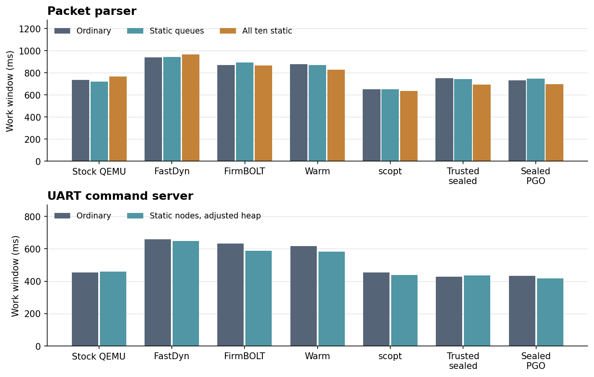

# Permanent storage for FreeRTOS application objects

The experiment starts with an ordinary `-Os` Cortex-M3 packet application. Four user tasks, four queues, a mutex and a periodic timer are created once during initialization and remain live. Their sizes follow from the program. Separate backing is reserved for each object. The kernel initializes the objects, copies queue payloads, manages waiters, invokes timer callbacks and runs the scheduler as usual. Static allocation changes pointer values, allocation failure possibilities and allocator observations.

The binary analysis starts from the application-declared once-entered function `main_compute`. On the stripped guest with its matching debug companion, the analysis recovered these six non-task sites. All six passed its intra-function checks.

| Object | Recovered shape or role |
|---|---|
| Free queue | 8 items × 1 byte |
| Work queue | 9 items × 1 byte |
| Result queue | 2 items × 68 bytes |
| Monitor queue | 4 items × 1 byte |
| Key/value mutex | One mutex |
| Heartbeat timer | One periodic timer, two ticks |

The queue-only variant changes four source sites. The combined variant also enables the existing four direct static task sites, the mutex and the timer. The two system tasks and the timer-service queue already used static storage in the baseline. Each selected constructor calls the FreeRTOS static API directly. This requires a source rebuild. [Discover candidate object sites](../../../../../docs/rtos-instance-analysis.md) · [Source transformation](https://github.com/boardrunner2049/firmbolt/blob/06c889d/tools/rtos-specialize/static_objects.py)

## Packet results

| Native time or footprint | Dynamic | Static queues | Static tasks | All ten static |
|---|---:|---:|---:|---:|
| Four queue creations, ms | 0.475 | 0.238 | 0.467 | 0.235 |
| Application initialization to scheduler entry, ms | 1.754 | 1.745 | 1.749 | 1.460 |
| Reset handler to scheduler entry, ms | 1.858 | 1.843 | 1.861 | 1.566 |
| Packet processing, ms | 937.3 | 920.0 | 899.5 | 1014.1 |
| Successful FreeRTOS allocations | 14 | 10 | 6 | 0 |
| Linked BSS, bytes | 110,868 | 111,329 | 117,384 | 15,553 |

Direct static storage gave a **1.993×** speedup across the four queue creations (95% paired interval **1.968–2.005×**). With the rest of the firmware dynamic, first-use heap setup moved to the mutex; the queue-only application initialization result was **1.003× (0.998–1.010×)**. With all ten static, reset-to-scheduler speedup was **1.189× (1.170–1.197×)**. The combined image freed **95,315 linked BSS bytes** versus ordinary. The 102,400-byte heap array and the allocator entry disappeared during ordinary section garbage collection. A separate relink with unresolved wraps of `pvPortMalloc` and `pvPortMallocStack` reproduced the same ROM bytes. The ordinary and queue-only builds failed that link at surviving allocation calls. Some `vPortFree` code remains in the combined image. This target’s reset handler branches directly to `main`, and the host supplies initialized RAM. The boot speedup therefore cannot be credited to a shorter guest BSS-clearing loop.

Steady packet processing in uncached FastDyn regressed on the combined build, **0.948× (0.917–0.960×)** dynamic/static. A separate flash placement control moved the application text by 0x1cc, returning the hot key/value update routine to its original address. Its total guest instruction count on the development stream stayed fixed, while that routine executed **1,088,633 fewer translation-block entries**. The revised static firmware ran **1.023× (1.012–1.037×)** faster than the first static placement, and its ratio against dynamic remained **0.960× (0.928–0.994×)**. This isolates a placement contribution and leaves a residual throughput regression. Select the combined conversion for boot latency or the measured RAM saving when that tradeoff fits the application; keep the heap-based or differently laid-out build available for sustained packet throughput.

The cold experiment used 40 same-core randomized process blocks and includes translation inside the guest window. The packet comparison used eight paired blocks, three real inputs and all 16 output words (96 scored runs). One stream was fresh. The placement comparison passed a further 72 checked runs. Compilation, process startup and diagnostics are outside these times.

## FreeRTOS+CLI command registrations

FreeRTOS+CLI's dynamic registration API allocates a linked-list node for each command description. The UART application registers four distinct commands once. Giving each its own node and calling the static registration API preserves insertion order and callback dispatch. The allocator was entered three times instead of seven. The unadjusted static build changed both free-heap values printed by `query-heap` from 98,016 to 98,080 bytes. Reducing this build's configured heap by 64 bytes restored both values to 98,016 and reduced linked BSS by 32 bytes compared with ordinary firmware. The ordinary and adjusted applications returned identical text for the mixed help/echo transcript. In 40 randomized cold blocks, registering the four commands took 0.534 ms in the ordinary firmware and 0.069 ms with static nodes and the adjusted heap, **7.678× (7.563–7.841×)**. The window includes first use of the allocator and cold translation. Application initialization from `main_compute` to scheduler entry gave **1.007× (0.994–1.015×)**. The remaining dynamic allocations move some first-use cost later. The figures describe cold registration and initialization on this specific UART image. [CLI registration example and source controls](https://github.com/boardrunner2049/firmbolt/blob/06c889d/tools/rtos-specialize/static-objects.md)

## Seven work-window configurations

The packet rows are independent panels and their absolute times include differences in host conditions. Use the paired cold and packet comparisons above for phase attribution. On UART the two builds were interleaved within each block. Each number is milliseconds, averaged over two per-input medians. The two applications have separate axes in the graph. Compilation, capture, qualification, process startup and boot are outside these work windows.



| Application and storage | Stock QEMU | FastDyn | FirmBOLT | Ordinary warm | Ordinary scopt | Trusted sealed | Sealed PGO |
|---|---:|---:|---:|---:|---:|---:|---:|
| Packet parser, ordinary | 734.2 | 937.5 | 868.5 | 875.8 | 652.5 | 751.6 | 732.2 |
| Packet parser, static queues | 719.3 | 944.8 | 894.9 | 871.2 | 652.1 | 742.2 | 746.8 |
| Packet parser, all ten static | 765.8 | 967.9 | 865.8 | 828.7 | 633.8 | 692.9 | 697.9 |
| UART command server, ordinary | 454.3 | 659.8 | 633.7 | 617.5 | 453.2 | 428.7 | 433.6 |
| UART command server, static nodes, adjusted heap | 458.7 | 648.0 | 588.9 | 583.4 | 439.3 | 436.3 | 418.5 |

## Reproduce the packet build

Start from separate staged packet demo copies and the matching GCC 13.3.1 toolchain as in the task-creation experiment. Set `T` to FastDyn's `tools/trebuchet` and `DEMO` to the staged `CORTEX_MPS2_QEMU_IAR_GCC` source. Write the transformed file to a new path and copy it into the isolated demo.

```sh
python -m scopt.analysis.rtos_storage packet.stripped.elf \
    --reference packet.debug.elf --once-function main_compute
python "$FIRMBOLT/tools/rtos-specialize/static_objects.py" \
    "$T/firmware/compute/main_compute.c" "$OUT/packet.c" --receipt "$OUT/sites.json" \
    --site xFreeQ=xQueueCreate --site xWorkQ=xQueueCreate \
    --site xResultQ=xQueueCreate --site xMonitorQ=xQueueCreate \
    --site xKvMutex=xSemaphoreCreateMutex --site xHeartbeatTimer=xTimerCreate
cp "$OUT/packet.c" "$DEMO/main_compute.c"
make -C "$DEMO/build/gcc" clean
TREBUCHET_CFLAGS='-DFW_WORKLOAD=0 -DTREBUCHET_DIRECT_STATIC_TASKS' \
    make -C "$DEMO/build/gcc" CC="$T/lib/ccopt.py Os" LD="$T/lib/ccopt.py Os"
```

For queues only use the four queue selectors and omit the task build flag. Build and capture each image separately. [Task-only controls](../task-creation/README.md) · [Capture and paired runtime replay](../../README.md)
