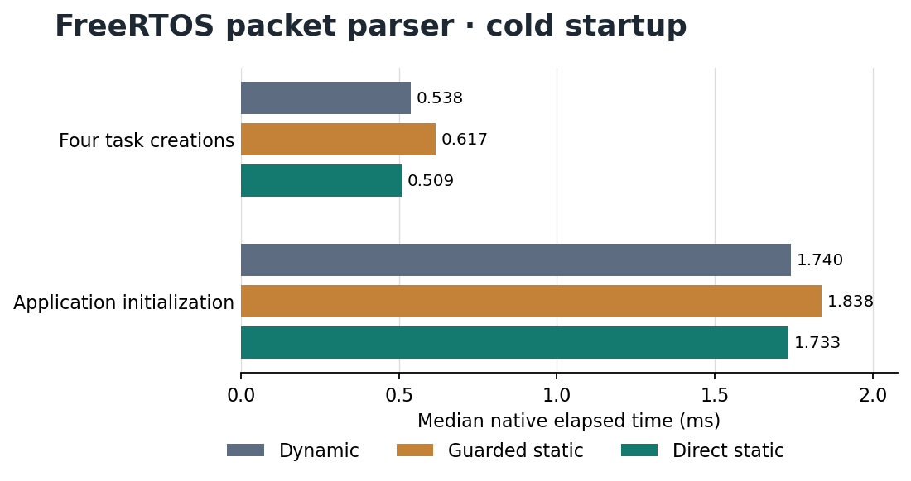

# Static application task creation

Four user registrations in the Cortex-M3 packet firmware execute once before scheduler startup. The monitor and aggregator each reserve 256 stack words, and the receiver and processor each reserve 512. The ordinary build allocates each stack and task control block from the heap. The direct build gives each registration separate aligned static storage and calls `xTaskCreateStatic`. The guarded build keeps a dynamic fallback for a repeated site, a changed depth or a running scheduler. All three retain the normal FreeRTOS task initialization and registration code. Two system tasks already use static creation in the baseline. [Discover the registrations and their source lines](https://github.com/boardrunner2049/firmbolt/blob/b7edae2/tools/rtos-specialize/boot-task-discovery.md) · [Storage and lifetime contract](https://github.com/boardrunner2049/firmbolt/blob/b7edae2/tools/rtos-specialize/boot-task.md)



| Native elapsed window, milliseconds | Dynamic | Guarded static | Direct static | Paired dynamic/direct, 95% interval |
|---|---:|---:|---:|---|
| Four user-task creations | 0.538 | 0.617 | 0.509 | **1.058× (1.053–1.066)** |
| Application initialization, main_compute to scheduler entry | 1.740 | 1.838 | 1.733 | **1.007× (0.999–1.021)** |
| Packet processing after task creation | 926.6 | 882.4 | 878.9 | **1.044× (1.002–1.080)** |

The two cold windows use 40 randomized process blocks on one core. The separate packet comparison uses eight paired blocks across two streams. All 48 scored packet executions matched all 16 outputs. Startup timing excludes compiling, starting the host process and loading the program. It includes QEMU translating newly encountered code inside the measured guest window. The direct change saved about 29 µs across the four creations. The full initialization interval includes queue, mutex and timer setup. Its uncertainty includes parity. The later packet interval also sees changed code layout and task addresses and cannot attribute its difference to the avoided startup allocations.

The four sites went from four dynamic and zero static user registrations to zero dynamic and four static registrations. Across the complete diagnostic input, allocator entry executions fell from 14 to six. Across the four creations, ordinary, guarded and direct forms executed 27,878, 27,145 and 27,016 guest instructions and translated 51, 56 and 45 new TBs, respectively. A separate specialization binding the two stack depths and the null task parameter kept all 14 allocations. With a matched compiler and C library, the bound clones ran twice each and the cold four-creation comparison gave 0.909× (0.898–0.918). The earlier scalar build linked a different libc and was excluded from that comparison.

Direct storage added 6,516 bytes of linked BSS with the heap held at 102,400 bytes. The guarded policy added 6,532. Both freed 6,592 bytes on the FreeRTOS heap. In separate builds, reducing the heap by that amount restored the ordinary build's measured minimum free heap of 95,160 bytes. Direct static then used 76 fewer total BSS bytes than ordinary, and guarded static used 60 fewer. Both adjusted builds produced all 16 expected words on both fixed packet inputs. Reserving storage changes task addresses, allocation failure behavior and allocator instrumentation. The measured recommendation is direct static storage for known, once-only startup sites whose application accepts that allocation contract.

## Seven packet-processing configurations

Each cell is work-window milliseconds, averaged over the two input medians in six interleaved process blocks. All four user tasks already exist when this window opens. Each row used its own guest and matching caches and ran as a separate panel. Cross-row differences also include host conditions and layout. Stock checks the 15 fields derivable from its result structure. FastDyn checks the complete 16-word application transcript.

| Task storage | 1 Stock QEMU | 2 FastDyn | 3 FirmBOLT | 4 Ordinary warm | 5 Ordinary scopt | 6 Trusted sealed | 7 Sealed PGO |
|---|---:|---:|---:|---:|---:|---:|---:|
| Dynamic (earlier panel) | 734.2 | 937.5 | 868.5 | 875.8 | 652.5 | 751.6 | 732.2 |
| Guarded static | 686.9 | 866.0 | 864.7 | 831.4 | 638.7 | 705.6 | 703.5 |
| Direct static | 702.3 | 861.9 | 859.3 | 832.8 | 636.5 | 681.2 | 663.0 |

Both static panels completed all 84 scored replays. A preliminary guarded panel hit a stock-QEMU debugger socket startup race after 52 scores. The published row comes from a full restart. The driver now retries the connection while QEMU starts. Setup and artifact qualification precede timing.

## Build the three variants

Use an isolated staged copy of the Trebuchet FreeRTOS packet demo for each build. Set `DEMO` to the copy of `CORTEX_MPS2_QEMU_IAR_GCC` and use matching Arm GCC 13.3.1 and nano libc on the path. The guarded build needs the header from FirmBOLT. The direct and ordinary builds use stock FreeRTOS headers.

```sh
T="$FASTDYN/tools/trebuchet"
cp "$T/firmware/compute/main_compute.c" "$DEMO/"
cp "$FIRMBOLT/tools/rtos-specialize/boot_task.h" "$DEMO/"
# POLICY can be empty, -DTREBUCHET_DIRECT_STATIC_TASKS, or -DTREBUCHET_GUARDED_STATIC_TASKS.
make -C "$DEMO/build/gcc" clean
TREBUCHET_CFLAGS="-DFW_WORKLOAD=0 $POLICY" make -C "$DEMO/build/gcc" \
    CC="$T/lib/ccopt.py Os" LD="$T/lib/ccopt.py Os"
arm-none-eabi-size "$DEMO/build/gcc/output/RTOSDemo.out"
```

Fresh builds through these switches reproduced the three measured loadable ROM images byte for byte. [Capture, optimization and paired replay](../../README.md)
